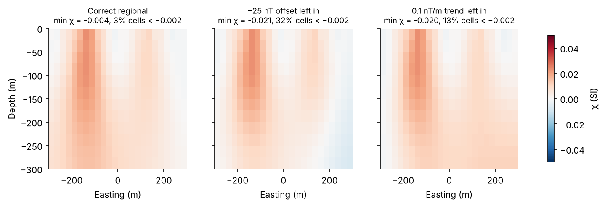
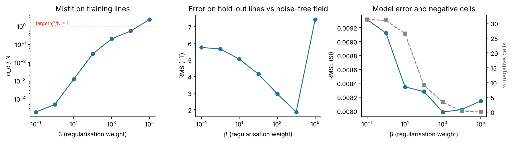
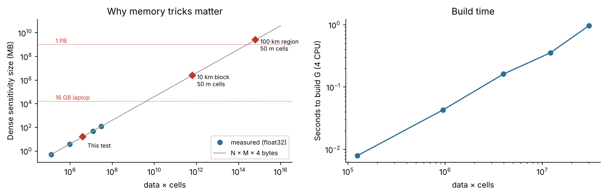

# Summary

This report is a first pass at all four tasks in Shrey Agarwal's email. It was prepared with AI research assistance (web search plus code). It is a starting point for discussion, not a finished review.

| Task | Status | Main result |
|---|---|---|
| 1. Literature review and ranking | Draft complete | 22 methods in 8 families are scored on 6 criteria, with 85 references. Combined methods rank highest. Shortlist: (1) PGI extended to three properties, with randomise-then-optimise for uncertainty; (2) an implicit geological model sampled with HMC or parallel tempering; (3) structural coupling with ensemble uncertainty, checked against a small HMC reference. |
| 2. Analyse and reproduce the attached paper | **Blocked: we do not have the paper** | Synthetic stress tests are done. They show that negative susceptibility is **not** evidence of remanence by itself: regional-field errors and over-fitting give the same result. A test protocol is ready for the real paper. |
| 3. Dataset report and better methods | Draft complete | 17 Finnish datasets are listed with resolution, access and known problems, with a QC checklist for each data type. 15 ideas from medical imaging, astrophysics and machine learning are ranked. |
| 4. Third physical property | Formulations drafted | Three Bayesian formulations are written out. Recommended first prototype: a latent lithology field with a petrophysical Gaussian mixture, with DC resistivity/IP as the third property. |

## Five key points

1. **Negative susceptibility needs a test, not an assumption.** In our synthetic test, a remanent body inverts to negative susceptibility (mean −0.014 SI against a true +0.03). But a −25 nT regional-field error with **no** remanence gave a larger negative extreme (−0.021 SI) and more negative cells (32 % against 21 %). Under-regularisation gives the same effect. The deciding test is this: with a positivity bound, remanent data **cannot be fit** (φd/N = 69). Without remanence, the data fit at φd/N = 0.24. Magnetisation vector inversion (MVI), amplitude inversion and GTK Q-ratios then confirm the cause.
2. **Over-fitting is easy to detect with hold-out flight lines.** As the regularisation weight β falls from 10⁴ to 10⁻¹, the training misfit falls by about 4 orders of magnitude. Over the same range the error on held-out lines increases from 1.9 nT to 5.7 nT. The best β gives φd/N ≈ 0.5–1, which agrees with the discrepancy principle.
3. **Memory is the real limit at regional scale.** A dense sensitivity matrix for a 100 km region with 50 m cells is about 2.6 PB. Each published efficiency approach (wavelet compression, data-space solves, octree meshes, on-the-fly GPU kernels) has a cost. The report lists these costs so that Alt Carbon's preferred approach can be compared fairly.
4. **The paper is not identified.** The best public candidate is arXiv:2602.03857, a GPU and data-space gravity inversion with GTK co-authors. Its version 1 uses Indian gravity data, not Hakku magnetics, so it is probably **not** the attached paper. We need the PDF.
5. **A research gap exists for Task 4.** We found no published work that does a fully sampled 3D joint inversion of gravity, magnetics and a third physics with a latent lithology field. This can be the core of a PhD chapter.

## What we need from Alt Carbon

1. The attached paper (PDF) and any code.
2. A Hakku account, or the line data for the study area.
3. A technical contact for weekly questions.
4. A short, permitted description of the current gravity–magnetic coupling (for Task 4).
5. Rules for publication and IP, and for the use of AI tools with confidential material.

## How to read the citations

Research agents collected the references through web search. Each reference has a DOI or arXiv ID that appeared in a search result. Items tagged **UNVERIFIED** need a manual check. Scores in the ranking tables are our **assessment**, not measured results.

# Task 1: Literature review of joint and probabilistic inversion

*Prepared for: Alt Carbon (3-D gravity + magnetic probabilistic joint inversion; adding a third property: IP / EM / seismic)*
*Compiled: 2026-11-09. Every reference was checked against a web search result; anything not checked is tagged **UNVERIFIED** (Section E).*

---

## 0. How to read this document

- **Problem framing.** We assume a voxel (or octree) model with about $10^6$ cells. Each cell holds a property vector $\mathbf{m}(x) = [\rho, \kappa\ \text{or}\ \mathbf{M}, \sigma\ \text{or}\ \eta\ \text{or}\ v_p]$. The data are $d_g$ (gravity), $d_m$ (TMI), and a third dataset $d_3$. The general objective or posterior is
  $$p(\mathbf{m}\mid \mathbf{d}) \propto \prod_{i} p(\mathbf{d}_i\mid F_i(\mathbf{m}_i))\; p_{\text{coupling}}(\mathbf{m}_1,\dots,\mathbf{m}_K)\; \prod_i p(\mathbf{m}_i),$$
  or, deterministically, $\phi(\mathbf{m}) = \sum_i \phi_d^{(i)} + \sum_i \beta_i \phi_m^{(i)} + \lambda\, \phi_c(\mathbf{m}_1,\dots,\mathbf{m}_K)$.
  The families below differ in **what $\phi_c$ / $p_{\text{coupling}}$ is** (sections 1–3, 6) and in **how the posterior is explored** (sections 4, 5, 7). Section 8 covers how the computation scales.
- **Scale reality check.** Gravity and magnetic forward operators are linear but dense. With $N=10^5$ data and $M=10^6$ cells, a dense double-precision sensitivity matrix needs $8NM \approx 800$ GB. A dense $M\times M$ posterior covariance is out of reach ($8\times10^{12}$ bytes). So at Alt Carbon's scale every UQ method has to be matrix-free, compressed, low-rank, or reduced-dimensional.
- **Scores in Section B are ASSESSMENTS** (my judgement from the literature), not measured benchmarks.

---

## A. Method families

### A1. Structural coupling (cross-gradient, joint total variation, Gramian, structure-guided)

**Core idea.** Different properties are assumed to change *at the same places*, so the coupling term rewards spatial alignment of gradients rather than any particular numerical relationship between the properties. That makes the approach the safe default when the petrophysical link is unknown or non-unique. Moorkamp et al. (2011) found that cross-gradient beat direct parameter coupling when the assumed relationship was violated. Gramian constraints generalise this: they penalise linear dependence between models, or between their gradients and other attributes, and can couple any number of properties.

**Key equations.**
- Cross-gradient (Gallardo & Meju 2003, 2004): $\mathbf{t}(m_i,m_j) = \nabla m_i \times \nabla m_j$, with $\phi_c = \sum_{i<j}\lVert \mathbf{t}(m_i,m_j)\rVert_2^2$.
- Joint total variation (Haber & Holtzman Gazit 2013): $\mathrm{JTV}(m_1,\dots,m_K) = \int_\Omega \sqrt{\textstyle\sum_{k=1}^K \lvert\nabla m_k\rvert^2 + \epsilon}\;dV$. It is convex, which makes it easier to optimise.
- Gramian (Zhdanov et al. 2012): $\phi_c = G(T m_1,\dots,T m_K) = \det\big[\langle T m_i, T m_j\rangle\big]_{i,j=1}^K$. Here $T$ is the identity (correlation coupling) or $\nabla$ (structural coupling).

**Foundational papers.**
- Haber & Oldenburg (1997), *Inverse Problems* 13(1):63–77. This is the original structural joint inversion.
- Gallardo & Meju (2003), *GRL* 30(13):1658, and Gallardo & Meju (2004), *JGR* 109:B03311. These introduced cross-gradients.
- Fregoso & Gallardo (2009), *Geophysics* 74(4):L31–L42. This is the 3-D cross-gradient method for gravity and magnetic data, the closest match to Alt Carbon's current pair.
- Gallardo & Meju (2011), *Rev. Geophys.* 49. A review of the structural approach.
- Moorkamp et al. (2011), *GJI* 184(1):477–493. A 3-D MT + gravity + seismic framework (jif3D) that compares direct coupling with cross-gradient coupling.
- Zhdanov, Gribenko & Wilson (2012), *GRL* 39:L09301. Introduced Gramian constraints.
- Haber & Holtzman Gazit (2013), *Surv. Geophys.* 34:675–695. Covers model fusion and JTV.

**Recent (2021+).**
- Giraud et al. (2021), *GMD* 14:6681–6709. Tomofast-x: open-source cross-gradient and petrophysical joint gravity–magnetic inversion.
- Vatankhah et al. (2022), *GJI* 230(3):1585–1611. Large-scale focusing gravity–magnetic joint inversion with a Gramian constraint.
- A 2024 *Surveys in Geophysics* review argues for combining Gramian terms to link the petrophysical and structural domains (DOI 10.1007/s10712-024-09832-0; authors UNVERIFIED).

**Open source.** Tomofast-x (Fortran/MPI, cross-gradient + clustering), jif3D (Moorkamp), SimPEG (`regularization.CrossGradient`, `JointTotalVariation`), pyGIMLi (structurally coupled joint inversion).

---

### A2. Petrophysical coupling (PGI / Gaussian mixture, fuzzy c-means, explicit relations)

**Core idea.** Each cell's property vector is assumed to come from one of a small number of rock units. Each unit has a characteristic (multivariate) distribution of physical properties. The coupling is a mixture prior, either a Gaussian mixture (PGI) or fuzzy clusters (FCM). Its parameters can be learned during the inversion, so the result is a property model plus a quasi-geology (unit membership) model. Explicit relations such as Gardner, Archie or a regression are the special case of one unit with a known function. They are powerful when correct and harmful when wrong (Moorkamp et al. 2011).

**Key equations.**
- PGI (Astic & Oldenburg 2019; Astic, Heagy & Oldenburg 2020). The prior is $p(\mathbf{m}) = \prod_{x}\sum_{k=1}^{K}\pi_k\,\mathcal{N}\big(\mathbf{m}(x)\mid\boldsymbol{\mu}_k,\boldsymbol{\Sigma}_k\big)$. The smallness term is approximately $\phi_s = \tfrac12\sum_x \lVert \mathbf{W}^{1/2}(\mathbf{m}(x)-\boldsymbol{\mu}_{z^*(x)})\rVert^2_{\boldsymbol{\Sigma}^{-1}_{z^*(x)}}$, where $z^*(x)=\arg\max_k \pi_k\mathcal{N}(\cdot)$. The GMM parameters $\{\pi,\mu,\Sigma\}$ are refit after each model update (MAP-EM with conjugate priors).
- FCM (Sun & Li 2016, 2017): $\phi_c = \sum_{j=1}^{M}\sum_{k=1}^{K} u_{jk}^{q}\,\lVert \mathbf{m}_j - \mathbf{v}_k\rVert^2$, subject to $\sum_k u_{jk}=1$ and $q>1$.
- Explicit relation: $m_2 = f(m_1)$, imposed either through $\phi_c = \lVert m_2 - f(m_1)\rVert^2$ or by substitution.

**Foundational papers.**
- Bosch & McGaughey (2001), *The Leading Edge* 20(8). Lithology-constrained gravity–magnetic joint inversion.
- Bosch et al. (2006), *Geophysics*. 3-D gravity–magnetic joint inversion by Monte Carlo (DOI 10.1190/1.2209952).
- Sun & Li (2016), *Geophysics* 81(3):ID37–ID57. Guided FCM joint inversion. The brief says 2015; the journal issue is dated 2016.
- Sun & Li (2017), *GJI* 208(2):1201–1216. Generalised fuzzy clustering.
- Astic & Oldenburg (2019), *GJI* 219(3):1989–2012. PGI framework.
- Astic, Heagy & Oldenburg (2020), *GJI* 224(1):40–68. Multi-physics PGI, demonstrated on gravity + magnetics over a kimberlite. The brief says 2021; the published volume is 2020.

**Recent (2021+).**
- Joint inversion of potential-field data over the DO-27 kimberlite with a GMM prior, *Interpretation*, DOI 10.1190/int-2019-0283.1. The search attributes it to Astic and co-authors; the exact author list and year are UNVERIFIED. The hypabyssal kimberlite there is *remanent*, a useful remanence test case.
- Heagy, Astic, Capriotti, Weis & Oldenburg (2022), arXiv:2203.13894. Gravity + magnetic inversion to delineate rocks for **CO₂ mineralisation**, which is directly on Alt Carbon's topic. The author list comes from a mirror and should be confirmed on arXiv.
- Giraud et al. (2021), *GMD*. Petrophysical clustering constraints in Tomofast-x.

**Open source.** SimPEG PGI (`simpeg.utils.WeightedGaussianMixture`, `regularization.PGI`); companion notebooks `simpeg-research/Astic-2019-PGI` and `Astic-2020-JointInversion`; Tomofast-x (ADMM clustering).

---

### A3. Geology-based parameterisations (level sets, parametric/shape inversion, implicit geomodels as priors)

**Core idea.** Instead of inverting for $10^6$ free voxel values, invert for the parameters of a *geological model*. Those can be level-set functions that define unit boundaries, wireframe or parametric surfaces, or the inputs of an implicit geological modeller (interface points, orientations, fault parameters). Physical properties are then assigned per unit, which couples all physics *by construction*: one geometry feeds every forward model. The parameter space shrinks to $10^1$–$10^4$ dimensions, which makes full Bayesian sampling feasible. The cost is a strong modelling assumption: the unit topology and the per-unit property distributions must be right.

**Key equations.**
- Multiple level sets: $\mathbf{m}(x) = \sum_{k} \mathbf{p}_k\,\chi_k(x)$ with $\chi_k$ built from $H(\varphi_k(x))$. The level-set functions evolve by $\partial_t\varphi = -v_n\lvert\nabla\varphi\rvert$, where $v_n$ comes from the misfit gradient.
- Implicit geomodel prior: $\mathbf{m} = \mathcal{P}\big(\mathcal{G}(\boldsymbol{\theta})\big)$ and $p(\boldsymbol{\theta}\mid\mathbf{d}) \propto \prod_i p\big(\mathbf{d}_i \mid F_i(\mathcal{P}_i(\mathcal{G}(\boldsymbol{\theta})))\big)\,p(\boldsymbol{\theta})$. Here $\mathcal{G}$ is the implicit (co-kriging or potential-field) interpolator that maps geological inputs to a unit field, and $\mathcal{P}_i$ assigns property $i$ to each unit, possibly drawn from a per-unit distribution.

**Foundational papers.**
- Zheglova, Farquharson & Hurich (2013), *GJI* 192(2):688–698. Level-set traveltime inversion.
- Zheglova, Lelièvre & Farquharson (2018), *Geophysics* 83(1):R13–R30. Multiple level-set *joint* inversion of traveltime and gravity data.
- Lelièvre, Farquharson & Hurich (2012), *Geophysics*. Joint traveltime–gravity inversion on unstructured meshes (DOI 10.1190/1.3513182).
- de la Varga, Schaaf & Wellmann (2019), *GMD* 12:1–32. GemPy: differentiable implicit modelling with gravity forward modelling.
- Wellmann & Caumon (2018), *Adv. Geophys.* 59:1–121. Review of 3-D structural model uncertainty.
- Wellmann et al. (2018), *Geol. Soc. Spec. Publ.* 453:41–56. Bayesian integration of geology and geophysics, Sandstone greenstone belt.

**Recent (2021+).**
- Grose et al. (2021), *GMD* 14:3915–3937. LoopStructural.
- Scalzo et al. (2022), *GMD* 15:3641–3662. Blockworlds: Bayesian gravity/magnetic inversion of kinematic implicit models. Shows that naive voxelisation distorts the likelihood.
- Giraud et al. (2024), *Solid Earth* 15:63–89. Automatic implicit geological modelling inside deterministic potential-field inversion.
- Liang (2023), RWTH Aachen PhD thesis. Derivative-informed Bayesian inference (gpCN, SVGD) for trainable geomodels with gravity.

**Open source.** GemPy (Python, autodiff), LoopStructural / map2loop (Loop3D), Blockworlds (Scalzo), Obsidian (Scalzo et al. 2019; parallel-tempered MCMC over parametric multi-sensor geology).

---

### A4. Bayesian sampling (MCMC, HMC, rjMCMC, parallel tempering, SVGD)

**Core idea.** Draw samples from $p(\mathbf{m}\mid\mathbf{d})$ instead of computing a single optimum. Random-walk Metropolis–Hastings is exact in the limit but scales badly with dimension. Gradient-based samplers such as HMC (and MALA) use adjoint gradients to take long, high-acceptance moves. Trans-dimensional rjMCMC lets the data choose the model complexity (for example the number of Voronoi cells). Parallel tempering handles multimodality. SVGD moves a set of interacting particles deterministically toward the posterior, and sits between MCMC and variational inference.

**Key equations.**
- Metropolis–Hastings: $\alpha = \min\!\Big(1, \frac{p(\mathbf{m}'\mid\mathbf{d})\,q(\mathbf{m}\mid\mathbf{m}')}{p(\mathbf{m}\mid\mathbf{d})\,q(\mathbf{m}'\mid\mathbf{m})}\Big)$. The dimension-robust pCN proposal is $\mathbf{m}' = \sqrt{1-\beta^2}\,\mathbf{m} + \beta\,\boldsymbol{\xi}$ with $\boldsymbol{\xi}\sim\mathcal{N}(0,\mathbf{C}_{\text{prior}})$.
- HMC: $H(\mathbf{m},\mathbf{p}) = -\log p(\mathbf{m}\mid\mathbf{d}) + \tfrac12\mathbf{p}^\top\mathbf{M}^{-1}\mathbf{p}$, integrated with leapfrog steps.
- rjMCMC: $\alpha = \min\!\Big(1,\frac{p(k',\mathbf{m}'\mid\mathbf{d})\,q(k\mid k')}{p(k,\mathbf{m}\mid\mathbf{d})\,q(k'\mid k)}\,\lvert\mathbf{J}\rvert\Big)$.
- Parallel tempering: chains target $p(\mathbf{d}\mid\mathbf{m})^{1/T_i}p(\mathbf{m})$ and swap states with probability $\min\!\big(1,\big[\tfrac{L(\mathbf{m}_j)}{L(\mathbf{m}_i)}\big]^{1/T_i-1/T_j}\big)$.
- SVGD: $\mathbf{m}_i \leftarrow \mathbf{m}_i + \epsilon\,\frac1N\sum_{j=1}^N\big[k(\mathbf{m}_j,\mathbf{m}_i)\nabla_{\mathbf{m}_j}\log p(\mathbf{m}_j\mid\mathbf{d}) + \nabla_{\mathbf{m}_j}k(\mathbf{m}_j,\mathbf{m}_i)\big]$.

**Foundational papers.**
- Mosegaard & Tarantola (1995), *JGR* 100(B7):12431–12447.
- Sambridge et al. (2006), *GJI* 167(2):528–542. Trans-dimensional inversion and the evidence.
- Bodin & Sambridge (2009), *GJI* 178(3):1411–1436. rjMCMC tomography.
- Sambridge (2014), *GJI* 196(1):357–374. Parallel tempering.
- Fichtner, Zunino & Gebraad (2019), *GJI* 216(2):1344–1363. HMC for tomography.

**Recent (2021+).**
- Boehm, Gebraad, Zunino & Fichtner (2021), *GJI* 227(2):941–968. Autotuned HMC: L-BFGS mass matrix, orders-of-magnitude gain in effective sample size.
- Zhang & Curtis (2020), *JGR* 125:e2019JB018589. ADVI and SVGD tomography, close to MCMC accuracy at lower cost.
- Gebraad, Boehm & Fichtner (2020), *JGR*, DOI 10.1029/2019JB018428. Elastic FWI with HMC.
- Ghalehnoei (2022), Univ. Calgary PhD thesis. **Probabilistic joint gravity–magnetic inversion with 3-D trans-dimensional earth and noise models.**
- Scalzo et al. (2019), *GMD* 12:2941–2960 (arXiv:1812.00318). Parallel-tempered MCMC with pCN for multi-sensor 3-D inversion (Obsidian). pCN beat random walk.

**Open source.** HMCLab (Gebraad/Fichtner, `larsgeb/hmclab`), Obsidian, BayesBay / Espresso (InLab, UNVERIFIED in this search), PyMC / NumPyro / BlackJAX (generic HMC/NUTS), `rjmcmc` libraries (Sambridge group, UNVERIFIED).

---

### A5. Variational and amortised inference (VI, normalising flows, simulation-based inference)

**Core idea.** Turn sampling into optimisation: choose $q_\phi(\mathbf{m})$ from a flexible family, such as a mean-field Gaussian (ADVI) or a normalising flow, to minimise $\mathrm{KL}(q\Vert p)$. *Amortised* or simulation-based inference (SBI) goes further. It trains a conditional density $q_\phi(\mathbf{m}\mid\mathbf{d})$ on simulated $(\mathbf{m},\mathbf{d})$ pairs, so a new survey is inverted in milliseconds. The catch is that it is only as good as the training prior, and it fails under distribution shift unless corrected with physics (Siahkoohi et al. 2023).

**Key equations.**
- ELBO: $\mathcal{L}(\phi) = \mathbb{E}_{q_\phi}\big[\log p(\mathbf{d}\mid\mathbf{m}) + \log p(\mathbf{m}) - \log q_\phi(\mathbf{m})\big]$.
- Flow: $\mathbf{m} = f_\phi(\mathbf{z})$ with $\mathbf{z}\sim\mathcal{N}(0,I)$ and $\log q_\phi(\mathbf{m}) = \log q_0(\mathbf{z}) - \log\lvert\det \partial f_\phi/\partial\mathbf{z}\rvert$.
- Amortised neural posterior estimation: $\min_\phi\ \mathbb{E}_{(\mathbf{m},\mathbf{d})\sim p(\mathbf{m})p(\mathbf{d}\mid\mathbf{m})}\big[-\log q_\phi(\mathbf{m}\mid\mathbf{d})\big]$.

**Foundational papers.**
- Cranmer, Brehmer & Louppe (2020), *PNAS* 117(48):30055–30062. Review of SBI.
- Zhang & Curtis (2020), *JGR*. VI tomography.
- Zhao, Curtis & Zhang (2022), *GJI* 228(1):213–239. Normalising-flow tomography.
- Zhang & Curtis (2021), *JGR* 126:e2021JB022320. Invertible neural networks.

**Recent (2021+).**
- Siahkoohi, Rizzuti, Orozco & Herrmann (2023), *Geophysics* 88. Amortised VI with physics-based latent correction.
- Rakoczi & Hammond (2023), arXiv:2311.07200. **Normalising flows for Bayesian gravity inversion**, the closest potential-field example.
- Levy, Laloy & Linde (2023), *Computers & Geosciences*. Inverse autoregressive flows with geostatistical priors (DOI not seen).
- Saoulis et al., *GJI*. SBI for full-waveform source inversion, which shows that Gaussian-likelihood assumptions give overconfident posteriors. Year and DOI UNVERIFIED.

**Open source.** `sbi` (Mackelab), `nflows` / `zuko`, Pyro / NumPyro (SVI), SLIM InvertibleNetworks.jl. I found no gravity- or magnetic-specific SBI code; this is a gap.

---

### A6. Learned priors (VAE/GAN latent priors, diffusion priors, deep image prior, supervised DL inversion)

**Core idea.** Replace hand-made regularisation with a prior learned from realistic geological realisations. With a VAE or GAN, the model is $\mathbf{m}=G(\mathbf{z})$ and the inversion or sampling happens in a low-dimensional latent space; Laloy et al. report compression ratios of 200–500. Diffusion models supply a score-based prior that can be combined with a likelihood gradient for posterior sampling. Deep image prior (DIP) needs *no training data*: it reparameterises $\mathbf{m}$ as the output of a randomly initialised CNN and relies on the network's implicit regularisation. Supervised end-to-end networks map data straight to models, which is fast but offers weak guarantees and little UQ.

**Key equations.**
- Latent prior: $p(\mathbf{z}\mid\mathbf{d}) \propto p\big(\mathbf{d}\mid F(G(\mathbf{z}))\big)\,\mathcal{N}(\mathbf{z};0,I)$.
- Diffusion posterior sampling: $\nabla_{\mathbf{m}_t}\log p_t(\mathbf{m}_t\mid\mathbf{d}) \approx s_\theta(\mathbf{m}_t,t) + \nabla_{\mathbf{m}_t}\log p\big(\mathbf{d}\mid \hat{\mathbf{m}}_0(\mathbf{m}_t)\big)$.
- DIP: $\mathbf{m}=f_\theta(\mathbf{z}_0)$ and $\theta^* = \arg\min_\theta \lVert F(f_\theta(\mathbf{z}_0))-\mathbf{d}\rVert^2_{\Gamma^{-1}}$.

**Foundational papers.**
- Laloy et al. (2017), *Adv. Water Resour.* 110:387–405. VAE parameterisation.
- Laloy et al. (2018), *WRR* 54(1):381–406. Spatial GAN with MCMC in latent space.
- Mosser, Dubrule & Blunt (2020), *Math. Geosci.* 52:53–79. GAN prior with MALA for seismic.
- Ulyanov, Vedaldi & Lempitsky, arXiv:1711.10925. Deep image prior. The CVPR 2018 venue is UNVERIFIED; an IJCV version has DOI 10.1007/s11263-020-01303-4.

**Recent (2021+).**
- Zhang et al. (2021/2022), *IEEE TGRS*, DOI 10.1109/TGRS.2021.3110606. Deep learning for 3-D gravity inversion (encoder–decoder, Vinton salt dome).
- DIP-Inv (2023), arXiv:2312.04752. CNN reparameterisation of DC-resistivity inversion with no training data (authors UNVERIFIED).
- Ravasi (2025), arXiv:2501.04881. Measurement-guided diffusion models (DPS/PGDM) for geophysical inverse problems.
- A 2026 preprint, arXiv:2603.19629, studies memorisation in learned (diffusion) priors and shows that a memorised prior collapses to a Gaussian mixture. This is a warning about over-confident posteriors.

**Open source.** `elaloy/SGANinv`, `lukasmosser/stochastic_seismic_waveform_inversion`, DIP reference code (Ulyanov), diffusers / score-SDE codebases (generic).

---

### A7. Ensemble and approximate UQ (EKI, randomise-then-optimise, Laplace, null-space)

**Core idea.** These methods approximate the posterior with *many optimisations*, *an ensemble of forward runs* or *local curvature*, so they can reuse a deterministic inversion engine.
- EKI is derivative-free. It updates an ensemble with sample covariances, and its solution lies in the span of the initial ensemble.
- Randomise-then-optimise (RTO) and randomised maximum likelihood (RML) solve perturbed MAP problems in parallel. RTO adds a Metropolis or importance-sampling correction.
- The Laplace approximation uses a Gaussian built on a low-rank Hessian at the MAP point.
- Null-space shuttles explore models that fit the data equally well without full sampling.

**Key equations.**
- EKI: $\mathbf{m}_j^{n+1} = \mathbf{m}_j^n + \mathbf{C}^{md}_n\big(\mathbf{C}^{dd}_n+\Gamma\big)^{-1}\big(\mathbf{d}+\boldsymbol{\eta}_j - F(\mathbf{m}^n_j)\big)$.
- Randomised MAP (RML-style; RTO adds a projection and an MH/IS weight): $\mathbf{m}_j = \arg\min_{\mathbf{m}} \lVert F(\mathbf{m})-(\mathbf{d}+\boldsymbol{\epsilon}_j)\rVert^2_{\Gamma^{-1}} + \lVert \mathbf{m}-(\mathbf{m}_0+\boldsymbol{\delta}_j)\rVert^2_{\mathbf{C}^{-1}}$.
- Laplace: $p(\mathbf{m}\mid\mathbf{d})\approx\mathcal{N}\big(\mathbf{m}_{\text{MAP}},\,(\mathbf{J}^\top\Gamma^{-1}\mathbf{J}+\mathbf{C}^{-1})^{-1}\big)$, with the low-rank form $\mathbf{C}^{1/2}(\mathbf{I}-\mathbf{V}_r\mathbf{D}_r\mathbf{V}_r^\top)\mathbf{C}^{1/2}$ and $\mathbf{D}_r=\mathrm{diag}\big(\lambda_i/(1+\lambda_i)\big)$.
- Null-space shuttle (linear case): $\mathbf{m}' = \mathbf{m}_{\text{MAP}} + \mathbf{P}_{\mathcal{N}}\,\delta\mathbf{m}$, with $\mathbf{P}_{\mathcal{N}}$ the projector onto the (effective) null space.

**Foundational papers.**
- Deal & Nolet (1996), *GJI* 124(2):372–380. Null-space shuttles.
- Iglesias, Law & Stuart (2013), *Inverse Problems* 29(4):045001. Ensemble Kalman inversion.
- Bui-Thanh, Ghattas, Martin & Stadler (2013), *SIAM J. Sci. Comput.* 35(6):A2494–A2523. Low-rank Laplace approximation at scale.
- Bardsley, Solonen, Haario & Laine (2014), *SIAM J. Sci. Comput.* 36(4):A1895–A1910. Randomise-then-optimise.
- Fichtner & Zunino (2019), *GRL* 46:644–651. Hamiltonian null-space shuttles, demonstrated on a magnetic example.

**Recent (2021+).**
- Tso et al. (2021), *GJI* 225(2):887–905. EKI with level sets for ERT.
- A 2024 *GJI* paper (vol. 236) applies EKI with level sets to **induced polarisation** data, which bears directly on a third property (Tso et al., authors partly verified).
- Boehm et al. (2021), *GJI*. Generalised null-space exploration.
- A 2025 *Scientific Reports* paper on regularised EKI for gravity (PMC12689625; authors UNVERIFIED).

**Open source.** hIPPYlib (Laplace and low-rank Hessian; UNVERIFIED in this search), `EnsembleKalmanProcesses.jl` (UNVERIFIED), pyGIMLi + EKI scripts (Tso), HMCLab (null-space shuttle).

---

### A8. Large-scale computation (compression, octree, matrix-free, GPU, equivalent sources, distributed)

**Core idea.** The dense potential-field sensitivity $\mathbf{G}\in\mathbb{R}^{N\times M}$ is the bottleneck. There are several ways to break it:
- compress it (wavelets: Li & Oldenburg 2003);
- shrink $M$ (adaptive octree meshes: Davis & Li 2011; Haber & Heldmann 2007 for EM);
- never store it (on-the-fly or matrix-free products on GPU);
- shrink $N$ or regularise the data first (equivalent sources: Soler & Uieda 2021);
- distribute it (Dask: SimPEG).

Every UQ method in sections A4–A7 inherits this cost per forward or adjoint call, multiplied by the number of samples, particles or ensemble members.

**Key equations.**
- $\mathbf{d}=\mathbf{G}\mathbf{m}$, with dense memory $8NM$ bytes.
- Wavelet compression: $\tilde{\mathbf{G}} = \mathcal{T}_\tau(\mathbf{G}\mathbf{W}^\top)$ and $\mathbf{G}\mathbf{m}\approx\tilde{\mathbf{G}}(\mathbf{W}\mathbf{m})$, keeping about $1$–$5\%$ of the coefficients.
- Equivalent sources: $\mathbf{d}\approx\mathbf{A}\mathbf{c}$ with sources fitted window by window (gradient boosting) at $\mathcal{O}(\text{window})$ memory.

**Foundational papers.**
- Li & Oldenburg (1996), *Geophysics* 61(2):394–408. 3-D magnetic inversion with depth weighting.
- Li & Oldenburg (2003), *GJI* 152(2):251–265. Wavelet compression with a log-barrier method.
- Haber & Heldmann (2007), *J. Comput. Phys.* Octree multigrid for quasi-static Maxwell's equations (volume and DOI UNVERIFIED).
- Davis & Li (2011), *GJI* 185:157–166. Adaptive mesh, space-filling curves and wavelets.
- Cockett et al. (2015), *Computers & Geosciences*. SimPEG.
- Heagy et al. (2017), *Computers & Geosciences* 107:1–19. SimPEG EM framework.

**Recent (2021+).**
- Soler & Uieda (2021), *GJI* 227(3):1768–1783. Gradient-boosted equivalent sources.
- Vatankhah et al. (2022), *GJI*. Large-scale Gramian joint inversion using reweighted CG.
- A GPU joint FTG inversion at the million-cell scale with compressed sensitivity, *IEEE TGRS*, DOI 10.1109/TGRS.2022.3147028 (authors UNVERIFIED).
- Dask-parallel SimPEG potential fields (ParCFD 2020 paper; Mira Geoscience `simpeg-drivers`, octree meshes).

**Open source.** SimPEG + discretize (octree, Dask), Harmonica / Fatiando (equivalent sources, prism/tesseroid forward), Tomofast-x (MPI, wavelet compression), pyGIMLi.

---

### A9. Remanent magnetisation (cross-cutting; it decides how the magnetic leg can be coupled)

**Core idea.** Strong remanence breaks the induced-only assumption $\mathbf{M}=\kappa\mathbf{H}_0$ of Li & Oldenburg (1996). There are two standard responses:
1. **MVI**: invert for a 3-component magnetisation vector per cell, in Cartesian or sparse spherical coordinates.
2. **Amplitude inversion**: invert $\lvert\mathbf{B}\rvert$, which is only weakly sensitive to magnetisation direction, for an effective susceptibility.

For joint inversion, a *scalar* that is safe to couple is the magnetisation amplitude $\lVert\mathbf{M}\rVert$. Coupling raw susceptibility to density is biased whenever remanence is present.

**Key equations.**
- MVI: $\mathbf{d}_m = \sum_{c\in\{x,y,z\}}\mathbf{G}_c\,\mathbf{M}_c$, with $\mathbf{M}=\kappa_{\text{eff}}\hat{\mathbf{H}}_0 + \mathbf{M}_\perp$.
- Amplitude: $\lvert\mathbf{B}\rvert = \sqrt{B_x^2+B_y^2+B_z^2}$, computed from TMI through equivalent sources.

**Papers.**
- Lelièvre & Oldenburg (2009), *Geophysics* 74(3):L21–L30. Total magnetisation vector inversion. The actual title is "A 3D total magnetization inversion applicable when significant, complicated remanence is present."
- Li, Shearer, Haney & Dannemiller (2010), *Geophysics* 75(1):L1–L11. Amplitude inversion and related approaches.
- Ellis, de Wet & Macleod (2012), ASEG Extended Abstracts. MVI, the basis of the commercial Geosoft method.
- Fournier, Heagy & Oldenburg (2020), *Geophysics* 85(3):J33–J49. Sparse MVI in spherical coordinates. This is the SimPEG implementation.

---

## B. Ranking table (scores are ASSESSMENTS)

Scale is 1 (poor) to 5 (best) in every column; higher is always better.
- **Assumptions:** 5 = mild or few assumptions.
- **UQ:** quality and calibration of the uncertainty the method yields.
- **Cost@1e6:** feasibility of time and memory with $10^6$ cells and $10^4$–$10^5$ data.
- **+3rd prop:** ease of adding IP, EM or seismic.
- **Remanence:** robustness when magnetic remanence is strong.
- **Maturity:** field use, documentation and open code.

| # | Method | Assump. | UQ | Cost@1e6 | +3rd prop | Remanence | Maturity | Total /30 |
|---|---|---|---|---|---|---|---|---|
| 1 | Cross-gradient (det.) | 4 | 1 | 4 | 3 | 4 | 5 | 21 |
| 2 | Joint total variation | 4 | 1 | 4 | 5 | 4 | 3 | 21 |
| 3 | Gramian | 3 | 1 | 4 | 5 | 3 | 3 | 19 |
| 4 | PGI (GMM, det.) | 3 | 2 | 4 | 5 | 2 | 4 | 20 |
| 5 | Fuzzy c-means | 3 | 1 | 4 | 4 | 2 | 3 | 17 |
| 6 | Explicit petrophysical relation | 1 | 1 | 5 | 3 | 1 | 4 | 15 |
| 7 | Level-set / parametric shape | 2 | 3 | 4 | 4 | 3 | 3 | 19 |
| 8 | Implicit-geomodel Bayesian (GemPy/Loop + MCMC/HMC) | 2 | 4 | 3 | 5 | 3 | 2 | 19 |
| 9 | Random-walk / pCN MCMC + parallel tempering (voxel) | 4 | 5 | 1 | 3 | 3 | 4 | 20 |
| 10 | HMC (voxel, adjoint gradients) | 4 | 5 | 2 | 3 | 3 | 3 | 20 |
| 11 | rjMCMC (trans-dimensional) | 5 | 5 | 1 | 2 | 3 | 3 | 19 |
| 12 | SVGD / particle VI | 4 | 3 | 2 | 3 | 3 | 2 | 17 |
| 13 | VI / normalising flow (per survey) | 3 | 3 | 2 | 3 | 3 | 2 | 16 |
| 14 | Amortised SBI / conditional NF | 2 | 3 | 3 | 2 | 2 | 1 | 13 |
| 15 | VAE/GAN latent prior + MCMC | 2 | 3 | 3 | 3 | 2 | 2 | 15 |
| 16 | Diffusion prior (DPS) | 2 | 3 | 2 | 3 | 2 | 1 | 13 |
| 17 | Deep image prior | 4 | 1 | 3 | 4 | 3 | 1 | 16 |
| 18 | Supervised DL end-to-end | 1 | 1 | 5 | 2 | 1 | 2 | 12 |
| 19 | Ensemble Kalman inversion | 3 | 3 | 3 | 4 | 3 | 3 | 19 |
| 20 | Randomise-then-optimise / RML | 3 | 4 | 3 | 5 | 4 | 3 | 22 |
| 21 | Low-rank Laplace | 2 | 3 | 4 | 4 | 3 | 3 | 19 |
| 22 | Null-space shuttle | 4 | 2 | 4 | 3 | 3 | 2 | 18 |

**One-line reasons (ASSESSMENT).**
1. **Cross-gradient.** Only assumes co-located boundaries. No UQ. Pairwise terms grow as $\binom{K}{2}$ and suffer from gradient degeneracy in smooth regions. MVI amplitude couples cleanly. Most widely used, with code in Tomofast-x, jif3D and SimPEG.
2. **JTV.** Similar assumptions; convex. A single term handles any $K$, so adding a third property is trivial. Less field history than cross-gradient.
3. **Gramian.** Can impose a correlation that does not exist. Generalises naturally to $K$ properties. Mostly the Zhdanov/TechnoImaging line and Vatankhah's large-scale work.
4. **PGI.** Needs a unit count and petrophysical samples. Gives unit-membership probabilities but not a calibrated posterior. Scales like a Tikhonov inversion. The GMM extends directly to 3-D property vectors. Scalar $\kappa$ is biased under remanence unless $\lVert\mathbf{M}\rVert$ is used. Mature in SimPEG.
5. **FCM.** Like PGI but non-probabilistic: memberships are not likelihoods. Fewer public implementations.
6. **Explicit relation.** Fragile, and fails silently when the relation does not hold (Moorkamp 2011). Remanence breaks density–susceptibility relations.
7. **Level sets.** Assume a discrete number of units with known properties. A low-dimensional state can be sampled. Topology changes are awkward.
8. **Implicit geomodel Bayesian.** Assumes the unit topology and stratigraphy. Best-calibrated *geological* uncertainty. Each forward model is fast but needs geology-to-mesh resampling. One geometry feeds every physics, so the third property is close to free. Research-grade.
9. **MCMC + PT (voxel).** Gold-standard UQ, but $10^5$–$10^7$ forward calls on $10^6$ cells is impractical without reduction. Fine on reduced parameterisations.
10. **HMC.** Gradients make it far better than random walk, and autotuning helps further, but it is still costly at $10^6$ cells. Each property adds an adjoint.
11. **rjMCMC.** Weakest assumptions (parsimony emerges from the data). Prohibitive in 3-D voxels. Cross-physics trans-dimensional moves are complex.
12. **SVGD.** Kernel collapse in high dimensions underestimates variance. 50–500 particles, each a full gradient.
13. **Per-survey VI / normalising flow.** Flow capacity limits $10^6$-cell posteriors. Mean-field ADVI under-disperses.
14. **Amortised SBI.** Inherits the training prior and is brittle under distribution shift. Training needs a huge number of 3-D simulations. Little potential-field literature.
15. **VAE/GAN prior.** Prior misspecification is the main risk. Latent MCMC is cheap. 3-D training sets are scarce in Indian geological settings.
16. **Diffusion prior.** Approximate likelihood guidance, plus memorisation risk. Expensive 3-D score networks. Very new for geophysics.
17. **DIP.** Implicit bias only; a multi-channel output head gives joint properties. No UQ unless ensembled.
18. **Supervised DL.** Strong train/test assumptions, little physics consistency, essentially no UQ; inference is instant.
19. **EKI.** Gaussian-ish updates and ensemble-subspace collapse. Derivative-free, so any black-box third solver works. Proven for ERT and IP.
20. **RTO / RML.** Exact only for linear-Gaussian problems, approximate otherwise. Embarrassingly parallel MAP solves that reuse the existing coupled objective, with an MH/IS correction available. Works with MVI.
21. **Laplace.** Local Gaussian only, poor for multimodal posteriors. A low-rank Hessian is feasible at $10^6$ cells.
22. **Null-space shuttle.** Explores equivalent models rather than giving probabilities. Cheap and deterministic.

**Ranking headline.** No single method wins every column. Petrophysical/structural coupling gives the *physics link*, sampling or ensembles give the *UQ*, and compression or reduced parameterisations make it *affordable*. The best designs combine one from each group (Section C).

---

## C. Top-3 shortlist with experiment plans

*Assumed context (not confirmed with Alt Carbon): exploration for mafic/ultramafic rocks suitable for CO₂ mineralisation (cf. Heagy et al. 2022, arXiv:2203.13894). The third property is most likely conductivity or chargeability from DC/IP or EM (serpentinisation, magnetite, sulphides), or $v_p$ from seismic refraction.*

### C1. Three-property PGI, made probabilistic with randomise-then-optimise

**Why.** It extends the gravity–magnetic GMM coupling directly to a 3-vector $[\rho, \lVert\mathbf{M}\rVert, \log\sigma\ \text{or}\ \eta]$ per cell. It reuses SimPEG at $10^6$ cells. Wrapping it in RTO/RML adds calibrated-ish UQ through parallel perturbed MAP solves.

**Experiment.**
1. Build a synthetic 3-D ultramafic intrusion with 4 units: host basalt, serpentinite, peridotite, and remanent magnetite-rich gabbro. Simulate gravity, TMI and DC/IP on an octree mesh ($\sim10^6$ cells). SimPEG + discretize.
2. Compare four configurations: (a) separate Tikhonov; (b) two-property PGI (gravity + magnetic); (c) three-property PGI with $\lVert\mathbf{M}\rVert$ from MVI; (d) the same with raw $\kappa$, to quantify remanence bias.
3. Run 32–64 RTO/RML solves on a Dask cluster. Compute the posterior mean and std per cell and the unit-membership probability.
4. **Metrics:** unit classification accuracy (confusion matrix), property RMSE, 90% interval coverage of true values, volume-of-reactive-rock estimate with credible interval, and wall time and memory.
5. **Go/no-go:** three-property PGI improves classification of the serpentinite unit by at least 15% over two-property PGI, and coverage stays between 0.8 and 0.95.

### C2. Implicit geological model as the joint parameterisation, sampled with HMC or parallel-tempered pCN

**Why.** Every physics is coupled through one geometry, which makes adding a property essentially free. Dimension drops to about $10^2$–$10^3$, so full MCMC with calibrated *geometric* UQ becomes feasible. This matches the Alt Carbon question "how much reactive rock, and where are its boundaries?"

**Experiment.**
1. Build the geology in GemPy (autodiff) or LoopStructural from a few interface points and orientations, plus per-unit property distributions $\mathcal{N}(\boldsymbol{\mu}_k,\boldsymbol{\Sigma}_k)$ for $(\rho,\lVert\mathbf{M}\rVert,\sigma)$.
2. Run forward models: prism gravity and magnetics (Harmonica or SimPEG) and DC/IP or EM (SimPEG) on a fixed octree. Use anti-aliased unit-to-mesh assignment (the Blockworlds lesson).
3. Sample with (a) parallel-tempered pCN (Obsidian-style) and (b) NUTS/HMC through JAX or PyTorch autodiff. Compare effective sample size per CPU-hour.
4. **Metrics:** posterior of contact depth and dip, posterior volume of the target unit, $\hat{R}$, and ESS. Also run a misspecification test in which the true model has an extra unit missing from the parameterisation.
5. **Deliverable:** probability-of-unit maps and volume distributions, which feed directly into CO₂-storage capacity estimates.

### C3. Structurally coupled voxel inversion (JTV or cross-gradient) with ensemble UQ (EKI vs SVGD vs low-rank Laplace)

**Why.** This is the fallback when petrophysics is poorly known; structure-only coupling is the safest assumption. The experiment benchmarks the three cheapest scalable UQ routes against a small-scale reference posterior.

**Experiment.**
1. Use the same synthetic as C1, but give the conductivity–density relation *no* consistent pattern, to stress-test petrophysical methods.
2. Joint objective with JTV across $(\rho, \lVert\mathbf{M}\rVert, \log\sigma)$, solved with SimPEG, using on-the-fly or compressed sensitivities.
3. Compute UQ three ways: EKI (derivative-free, 100–200 members), SVGD (50–100 particles, adjoint gradients) and low-rank Laplace at the MAP point (randomised eigensolver, $r\approx200$–$500$).
4. Reference posterior: on a $64^3$ downscaled version, run long HMC (HMCLab) as ground truth. Compare marginal variances, KL or Wasserstein distance per cell, and calibration.
5. **Metrics:** variance ratio against HMC (target 0.7–1.3), compute cost (forward-equivalents), and how the error grows from $64^3$ to $10^6$ cells.

*Watch-list (not top-3 yet):* VAE/GAN or diffusion latent priors trained on GemPy/Loop ensembles. These are promising for speed, but the 3-D potential-field evidence is thin and there is a memorisation and prior-misspecification risk.

---

## D. Five open research gaps

1. **Calibrated UQ for 3-property joint inversion at $10^6$ cells.** No published work combines petrophysical (GMM) coupling, ≥3 physics, remanence-aware magnetics and a validated posterior at production scale. PGI is deterministic; Ghalehnoei's (2022) Bayesian gravity–magnetic work is two-physics.
2. **Probabilistic coupling under remanence.** The joint posterior over $(\rho,\mathbf{M}\ \text{vector},\sigma)$ is non-Gaussian. Amplitude/MVI parameterisations add non-linearity, and no standard prior on remanence direction exists for joint Bayesian schemes.
3. **Uncertain coupling strength and form.** The weights $\lambda$, the GMM component count and the relevance of the cross-gradient term are tuned by hand. Hierarchical Bayes or evidence-based model selection between coupling types (structural, petrophysical, none) is largely unexplored for potential fields. The evidence itself is contested (Mosegaard 2023, arXiv:2308.05858; not read in full).
4. **Bridging geology-parameterised and voxel inversions.** Implicit-model posteriors are well calibrated but misspecified when unit topology is wrong. Voxel posteriors are flexible but poorly calibrated. Hybrid "geometry + residual field" models, with consistent likelihoods (Blockworlds aliasing) and gradients through the geomodeller, are an open design space.
5. **Learned priors and SBI for potential fields with distribution-shift guarantees.** Gravity and magnetic SBI or diffusion work is nearly absent (Rakoczi & Hammond 2023 is an exception). Methods are needed for physics-corrected amortisation (à la Siahkoohi et al. 2023), memorisation diagnostics, and training-set design for under-mapped terranes such as Indian cratons and the Deccan basalts.

---

## E. Bibliography

**Tags.**
- **VERIFIED**: authors, year, title, venue and DOI or arXiv ID all appeared in a search result seen during compilation.
- **PARTIAL**: the core record was seen, but some field (named) was not confirmed.
- **UNVERIFIED**: not confirmed. Do not cite without checking.

DOIs are given only where one appeared in a search result.

### Structural coupling
1. Haber, E. & Oldenburg, D.W. (1997). Joint inversion: a structural approach. *Inverse Problems* 13(1), 63–77. doi:10.1088/0266-5611/13/1/006. **VERIFIED**
2. Gallardo, L.A. & Meju, M.A. (2003). Characterization of heterogeneous near-surface materials by joint 2D inversion of dc resistivity and seismic data. *GRL* 30(13), 1658. doi:10.1029/2003GL017370. **VERIFIED**
3. Gallardo, L.A. & Meju, M.A. (2004). Joint two-dimensional DC resistivity and seismic travel time inversion with cross-gradients constraints. *JGR* 109, B03311. doi:10.1029/2003JB002716. **VERIFIED**
4. Fregoso, E. & Gallardo, L.A. (2009). Cross-gradients joint 3D inversion with applications to gravity and magnetic data. *Geophysics* 74(4), L31–L42. doi:10.1190/1.3119263. **VERIFIED**
5. Gallardo, L.A. & Meju, M.A. (2011). Structure-coupled multiphysics imaging in geophysical sciences. *Rev. Geophys.* 49. doi:10.1029/2010RG000330. **VERIFIED**
6. Moorkamp, M., Heincke, B., Jegen, M., Roberts, A.W. & Hobbs, R.W. (2011). A framework for 3-D joint inversion of MT, gravity and seismic refraction data. *GJI* 184(1), 477–493. doi:10.1111/j.1365-246X.2010.04856.x. **VERIFIED**
7. Zhdanov, M.S., Gribenko, A. & Wilson, G. (2012). Generalized joint inversion of multimodal geophysical data using Gramian constraints. *GRL* 39, L09301. doi:10.1029/2012GL051233. **VERIFIED**
8. Haber, E. & Holtzman Gazit, M. (2013). Model fusion and joint inversion. *Surv. Geophys.* 34, 675–695. doi:10.1007/s10712-013-9232-4. **VERIFIED**
9. Meju, M.A. & Gallardo, L.A. (2016). Structural coupling approaches in integrated geophysical imaging. In *Integrated Imaging of the Earth*, AGU Geophys. Monogr. 218, ch. 4. DOI not seen. **PARTIAL**
10. Vatankhah, S., Renaut, R.A., Huang, X., Mickus, K. & Gharloghi, M. (2022). Large-scale focusing joint inversion of gravity and magnetic data with Gramian constraint. *GJI* 230(3), 1585–1611. doi:10.1093/gji/ggac138; arXiv:2112.15562. **VERIFIED**
11. Vatankhah, S. et al. (2020 preprint). Generalized Lp-norm joint inversion of gravity and magnetic data using cross-gradient constraint. arXiv:2001.03579. **PARTIAL** (full author list and journal version not confirmed)
12. Anonymous review (2024). Gramian coupling terms in joint inversion. *Surv. Geophys.* doi:10.1007/s10712-024-09832-0. **UNVERIFIED** (authors and title not seen)

### Petrophysical coupling
13. Bosch, M. & McGaughey, J. (2001). Joint inversion of gravity and magnetic data under lithologic constraints. *The Leading Edge* 20(8). doi:10.1190/1.1487299. **VERIFIED**
14. Bosch, M. et al. (2006). Joint gravity and magnetic inversion in 3D using Monte Carlo methods. *Geophysics*. doi:10.1190/1.2209952. **PARTIAL** (co-authors and pages not seen)
15. Sun, J. & Li, Y. (2016). Joint inversion of multiple geophysical data using guided fuzzy c-means clustering. *Geophysics* 81(3), ID37–ID57. doi:10.1190/geo2015-0457.1. **VERIFIED**
16. Sun, J. & Li, Y. (2017). Joint inversion of multiple geophysical and petrophysical data using generalized fuzzy clustering algorithms. *GJI* 208(2), 1201–1216. doi:10.1093/gji/ggw442. **VERIFIED**
17. Astic, T. & Oldenburg, D.W. (2019). A framework for petrophysically and geologically guided geophysical inversion using a dynamic Gaussian mixture model prior. *GJI* 219(3), 1989–2012. doi:10.1093/gji/ggz389. **VERIFIED**
18. Astic, T., Heagy, L.J. & Oldenburg, D.W. (2020). Petrophysically and geologically guided multi-physics inversion using a dynamic Gaussian mixture model. *GJI* 224(1), 40–68. doi:10.1093/gji/ggaa378; arXiv:2002.09515. **VERIFIED** (the brief's "2021" should read 2020)
19. [Astic, T. et al.] Joint inversion of potential-fields data over the DO-27 kimberlite pipe using a Gaussian mixture model prior. *Interpretation*. doi:10.1190/int-2019-0283.1. **PARTIAL** (authors and year not confirmed)
20. Heagy, L.J., Astic, T., Capriotti, J., Weis, J. & Oldenburg, D.W. (2022). Geophysical inversions to delineate rocks with CO₂ sequestration potential through carbon mineralization. arXiv:2203.13894. **PARTIAL** (author list from a mirror)

### Geology-based parameterisations
21. Lelièvre, P.G., Farquharson, C.G. & Hurich, C.A. (2012). Joint inversion of seismic traveltimes and gravity data on unstructured grids with application to mineral exploration. *Geophysics*. doi:10.1190/1.3513182. **PARTIAL** (volume and pages not seen)
22. Zheglova, P., Farquharson, C.G. & Hurich, C.A. (2013). 2-D reconstruction of boundaries with level set inversion of traveltimes. *GJI* 192(2), 688–698. doi:10.1093/gji/ggs035. **VERIFIED**
23. Zheglova, P., Lelièvre, P.G. & Farquharson, C.G. (2018). Multiple level-set joint inversion of traveltime and gravity data with application to ore delineation: a synthetic study. *Geophysics* 83(1), R13–R30. doi:10.1190/geo2016-0675.1. **VERIFIED**
24. Wellmann, F. & Caumon, G. (2018). 3-D structural geological models: concepts, methods, and uncertainties. *Adv. Geophys.* 59, 1–121. doi:10.1016/bs.agph.2018.09.001. **VERIFIED**
25. Wellmann, F., de la Varga, M., Murdie, R.E., Gessner, K. & Jessell, M. (2018). Uncertainty estimation for a geological model of the Sandstone greenstone belt, Western Australia: insights from integrated geological and geophysical inversion in a Bayesian inference framework. *Geol. Soc. London Spec. Publ.* 453, 41–56. DOI not seen. **PARTIAL**
26. de la Varga, M., Schaaf, A. & Wellmann, F. (2019). GemPy 1.0: open-source stochastic geological modeling and inversion. *GMD* 12, 1–32. doi:10.5194/gmd-12-1-2019. **VERIFIED**
27. Giraud, J., Lindsay, M., Ogarko, V., Jessell, M., Martin, R. & Pakyuz-Charrier, E. (2019). Integration of geoscientific uncertainty into geophysical inversion by means of local gradient regularization. *Solid Earth* 10(1), 193–. DOI not displayed (URL se-10-193-2019). **PARTIAL**
28. Giraud, J., Ogarko, V., Lindsay, M., Pakyuz-Charrier, E., Jessell, M. & Martin, R. (2019). Sensitivity of constrained joint inversions to geological and petrophysical input data uncertainties with posterior geological analysis. *GJI* 218(1), 666–688. DOI not seen. **PARTIAL**
29. Giraud, J., Lindsay, M., Jessell, M. & Ogarko, V. (2020). Towards plausible lithological classification from geophysical inversion: honouring geological principles in subsurface imaging. *Solid Earth* 11, 419–436. doi:10.5194/se-11-419-2020. **VERIFIED**
30. Giraud, J., Ogarko, V., Martin, R., Jessell, M. & Lindsay, M. (2021). Structural, petrophysical, and geological constraints in potential field inversion using the Tomofast-x v1.0 open-source code. *GMD* 14, 6681–6709. doi:10.5194/gmd-14-6681-2021. **VERIFIED**
31. Grose, L., Ailleres, L., Laurent, G. & Jessell, M. (2021). LoopStructural 1.0: time-aware geological modelling. *GMD* 14, 3915–3937. doi:10.5194/gmd-14-3915-2021. **VERIFIED**
32. Scalzo, R., Lindsay, M., Jessell, M., Pirot, G., Giraud, J., Cripps, E. & Cripps, S. (2022). Blockworlds 0.1.0 [full subtitle not seen]. *GMD* 15(9), 3641–3662. doi:10.5194/gmd-15-3641-2022. **VERIFIED** (subtitle not captured)
33. Giraud, J., Caumon, G., Grose, L., Ogarko, V. & Cupillard, P. (2024). Integration of automatic implicit geological modelling in deterministic geophysical inversion. *Solid Earth* 15, 63–89. doi:10.5194/se-15-63-2024. **VERIFIED**
34. Liang, Z. (2023). Derivative-informed Bayesian inference for trainable geological modeling in modern machine-learning framework. PhD thesis, RWTH Aachen (advisers Wellmann and Ghattas). **PARTIAL** (no DOI)
35. Liang, Z. & Wellmann, F. (2021). Hessian-informed MCMC (gpCN) for 3-D model-based gravity Bayesian inversion. **UNVERIFIED** (exact title and venue not seen)

### Bayesian sampling
36. Mosegaard, K. & Tarantola, A. (1995). Monte Carlo sampling of solutions to inverse problems. *JGR* 100(B7), 12431–12447. doi:10.1029/94JB03097. **VERIFIED**
37. Sambridge, M., Gallagher, K., Jackson, A. & Rickwood, P. (2006). Trans-dimensional inverse problems, model comparison and the evidence. *GJI* 167(2), 528–542. DOI not seen. **PARTIAL**
38. Bodin, T. & Sambridge, M. (2009). Seismic tomography with the reversible jump algorithm. *GJI* 178(3), 1411–1436. doi:10.1111/j.1365-246X.2009.04226.x. **VERIFIED**
39. Sambridge, M. (2014). A parallel tempering algorithm for probabilistic sampling and multimodal optimization. *GJI* 196(1), 357–374. doi:10.1093/gji/ggt342. **VERIFIED**
40. Fichtner, A., Zunino, A. & Gebraad, L. (2019). Hamiltonian Monte Carlo solution of tomographic inverse problems. *GJI* 216(2), 1344–1363. doi:10.1093/gji/ggy496. **VERIFIED**
41. Scalzo, R., Kohn, D., Olierook, H., Houseman, G., Chandra, R., Girolami, M. & Cripps, S. (2019). Efficiency and robustness in Monte Carlo sampling for 3-D geophysical inversions with Obsidian v0.1.2: setting up for success. *GMD* 12(7), 2941–2960. arXiv:1812.00318. **VERIFIED** (DOI not displayed; Copernicus URL gmd-12-2941-2019)
42. Gebraad, L., Boehm, C. & Fichtner, A. (2020). Bayesian elastic full-waveform inversion using Hamiltonian Monte Carlo. *JGR Solid Earth*. doi:10.1029/2019JB018428. **VERIFIED** (volume not checked)
43. Zhang, X. & Curtis, A. (2020). Seismic tomography using variational inference methods. *JGR Solid Earth* 125, e2019JB018589. doi:10.1029/2019JB018589; arXiv:1908.08356. **VERIFIED**
44. Boehm, C., Gebraad, L., Zunino, A. & Fichtner, A. (2021). Autotuning Hamiltonian Monte Carlo for efficient generalized nullspace exploration. *GJI* 227(2), 941–968. doi:10.1093/gji/ggab270. **VERIFIED**
45. Ghalehnoei, E. (2022). Probabilistic joint inversion of gravity and magnetic data with 3D trans-dimensional earth and noise models. PhD thesis, University of Calgary (PRISM repository). **PARTIAL** (author name spelled "Ghaleh Noei" in the search result)
46. Moyer, [first name not seen] (2023/2024). Improvements to a probabilistic joint inversion of magnetic and gravimetric data. Krell Institute CSGF abstract. **UNVERIFIED** (full name and venue)

### Variational / amortised / SBI
47. Cranmer, K., Brehmer, J. & Louppe, G. (2020). The frontier of simulation-based inference. *PNAS* 117(48), 30055–30062. doi:10.1073/pnas.1912789117; arXiv:1911.01429. **VERIFIED**
48. Zhang, X. & Curtis, A. (2021). Bayesian geophysical inversion using invertible neural networks. *JGR Solid Earth* 126, e2021JB022320. doi:10.1029/2021JB022320. **VERIFIED**
49. Zhao, X., Curtis, A. & Zhang, X. (2022). Bayesian seismic tomography using normalizing flows. *GJI* 228(1), 213–239. doi:10.1093/gji/ggab298. **VERIFIED**
50. Siahkoohi, A., Rizzuti, G., Orozco, R. & Herrmann, F.J. (2023). Reliable amortized variational inference with physics-based latent distribution correction. *Geophysics* 88. doi:10.1190/geo2022-0472.1; arXiv:2207.11640. **VERIFIED**
51. Rakoczi, H. & Hammond, G. (2023). Normalising flows for Bayesian gravity inversion. arXiv:2311.07200. **PARTIAL** (first names and the final title capitalisation not confirmed)
52. Levy, S., Laloy, E. & Linde, N. (2023). Variational Bayesian inference with complex geostatistical priors using inverse autoregressive flows. *Computers & Geosciences*. **PARTIAL** (DOI and first names not seen)
53. Saoulis, A. et al. Full-waveform earthquake source inversion using simulation-based inference. *GJI*; arXiv:2410.23238. **PARTIAL** (year, volume and DOI not seen)

### Learned priors
54. Laloy, E., Hérault, R., Lee, J., Jacques, D. & Linde, N. (2017). Inversion using a new low-dimensional representation of complex binary geological media based on a deep neural network. *Adv. Water Resour.* 110, 387–405. doi:10.1016/j.advwatres.2017.09.029; arXiv:1710.09196. **VERIFIED**
55. Laloy, E., Hérault, R., Jacques, D. & Linde, N. (2018). Training-image based geostatistical inversion using a spatial generative adversarial neural network. *WRR* 54(1), 381–406. doi:10.1002/2017WR022148; arXiv:1708.04975. **VERIFIED**
56. Ulyanov, D., Vedaldi, A. & Lempitsky, V. Deep image prior. arXiv:1711.10925 (2017). IJCV version doi:10.1007/s11263-020-01303-4. **PARTIAL** (CVPR 2018 venue UNVERIFIED)
57. Mosser, L., Dubrule, O. & Blunt, M.J. (2020). Stochastic seismic waveform inversion using generative adversarial networks as a geological prior. *Math. Geosci.* 52, 53–79. doi:10.1007/s11004-019-09832-6; arXiv:1806.03720. **VERIFIED**
58. Zhang, [initials not seen] et al. (2021/2022). Deep learning for 3-D inversion of gravity data. *IEEE TGRS*. doi:10.1109/TGRS.2021.3110606. **PARTIAL** (author list not seen)
59. [Authors not seen] (2023). A test-time learning approach to reparameterize the geophysical inverse problem with a convolutional neural network (DIP-Inv). arXiv:2312.04752. **PARTIAL** (authors UNVERIFIED)
60. Ravasi, M. (2025). Solving geophysical inverse problems with measurement-guided diffusion models. arXiv:2501.04881. **PARTIAL** (single-author attribution from the search summary)
61. [Authors not seen] (2026). On the role of memorization in learned priors for geophysical inverse problems. arXiv:2603.19629. **PARTIAL**

### Ensemble / approximate UQ
62. Deal, M.M. & Nolet, G. (1996). Nullspace shuttles. *GJI* 124(2), 372–380. doi:10.1111/j.1365-246X.1996.tb07027.x. **VERIFIED**
63. Iglesias, M.A., Law, K.J.H. & Stuart, A.M. (2013). Ensemble Kalman methods for inverse problems. *Inverse Problems* 29(4), 045001. doi:10.1088/0266-5611/29/4/045001; arXiv:1209.2736. **VERIFIED**
64. Bui-Thanh, T., Ghattas, O., Martin, J. & Stadler, G. (2013). A computational framework for infinite-dimensional Bayesian inverse problems. Part I: the linearized case, with application to global seismic inversion. *SIAM J. Sci. Comput.* 35(6), A2494–A2523. doi:10.1137/12089586X; arXiv:1308.1313. **VERIFIED**
65. Bardsley, J.M., Solonen, A., Haario, H. & Laine, M. (2014). Randomize-then-optimize: a method for sampling from posterior distributions in nonlinear inverse problems. *SIAM J. Sci. Comput.* 36(4), A1895–A1910. doi:10.1137/140964023. **VERIFIED**
66. Fichtner, A. & Zunino, A. (2019). Hamiltonian nullspace shuttles. *GRL* 46, 644–651. doi:10.1029/2018GL080931. **VERIFIED**
67. Tso, C.-H.M., Iglesias, M., Wilkinson, P., Kuras, O., Chambers, J. & Binley, A. (2021). Efficient multiscale imaging of subsurface resistivity with uncertainty quantification using ensemble Kalman inversion. *GJI* 225(2), 887–905. doi:10.1093/gji/ggab013. **VERIFIED**
68. Tso, C.-H.M. et al. (2024). Ensemble Kalman inversion of induced polarization data. *GJI* 236. **PARTIAL** (co-authors and DOI not seen)
69. [Authors not seen] (2025). Regularized ensemble Kalman inversion for robust and efficient gravity data modeling to identify mineral and ore deposits. *Scientific Reports* (PMC12689625). **UNVERIFIED** (authors and DOI)
70. Mosegaard, K. (2023). Critique of the Bayesian evidence for model selection in physical inversion. arXiv:2308.05858. **PARTIAL** (exact title not seen)

### Large-scale computation and software
71. Li, Y. & Oldenburg, D.W. (1996). 3-D inversion of magnetic data. *Geophysics* 61(2), 394–408. DOI not seen. **PARTIAL**
72. Li, Y. & Oldenburg, D.W. (2003). Fast inversion of large-scale magnetic data using wavelet transforms and a logarithmic barrier method. *GJI* 152(2), 251–265. doi:10.1046/j.1365-246X.2003.01766.x. **VERIFIED**
73. Haber, E. & Heldmann, S. (2007). An octree multigrid method for quasi-static Maxwell's equations with highly discontinuous coefficients. *J. Comput. Phys.* **PARTIAL** (volume, pages and DOI not seen)
74. Davis, K. & Li, Y. (2011). Fast solution of geophysical inversion using adaptive mesh, space-filling curves and wavelet compression. *GJI* 185, 157–166. DOI not seen. **PARTIAL**
75. Cockett, R., Kang, S., Heagy, L.J., Pidlisecky, A. & Oldenburg, D.W. (2015). SimPEG: an open source framework for simulation and gradient based parameter estimation in geophysical applications. *Computers & Geosciences*. DOI not seen. **PARTIAL**
76. Heagy, L.J., Cockett, R., Kang, S., Rosenkjaer, G.K. & Oldenburg, D.W. (2017). A framework for simulation and inversion in electromagnetics. *Computers & Geosciences* 107, 1–19. doi:10.1016/j.cageo.2017.06.018; arXiv:1610.00804. **VERIFIED**
77. Rücker, C., Günther, T. & Wagner, F.M. (2017). pyGIMLi: an open-source library for modelling and inversion in geophysics. *Computers & Geosciences* 109, 106–123. doi:10.1016/j.cageo.2017.07.011. **VERIFIED**
78. Soler, S.R. & Uieda, L. (2021). Gradient-boosted equivalent sources. *GJI* 227(3), 1768–1783. doi:10.1093/gji/ggab297. **VERIFIED**
79. [Authors not seen] (2022). Joint nonlinear inversion of full tensor gravity gradiometry data and its parallel algorithm. *IEEE TGRS*. doi:10.1109/TGRS.2022.3147028. **PARTIAL**
80. Caprioti/Capriotti, Heagy & Fournier (2020). Dask-parallel SimPEG for large-scale potential-field inversion. ParCFD 2020. **UNVERIFIED** (title and author spellings)
81. Fatiando a Terra / Harmonica v0.6.0 (2023). Zenodo record 7690145. **PARTIAL** (software citation)

### Remanence
82. Lelièvre, P.G. & Oldenburg, D.W. (2009). A 3D total magnetization inversion applicable when significant, complicated remanence is present. *Geophysics* 74(3), L21–L30. doi:10.1190/1.3103249. **VERIFIED**
83. Li, Y., Shearer, S.E., Haney, M.M. & Dannemiller, N. (2010). Comprehensive approaches to 3D inversion of magnetic data affected by remanent magnetization. *Geophysics* 75(1), L1–L11. doi:10.1190/1.3294766. **VERIFIED**
84. Ellis, R.G., de Wet, B. & Macleod, I.N. (2012). Inversion of magnetic data for remanent and induced sources. *ASEG Extended Abstracts* 2012(1), 1–4. doi:10.1071/ASEG2012ab117. **VERIFIED**
85. Fournier, D., Heagy, L.J. & Oldenburg, D.W. (2020). Sparse magnetic vector inversion in spherical coordinates. *Geophysics* 85(3), J33–J49. doi:10.1190/geo2019-0244.1. **VERIFIED** (pages given inconsistently across sources)

---

### Corrections to the brief (found during verification)
- Astic, Heagy & Oldenburg's multi-physics PGI is **GJI 2020** (224(1):40–68), not 2021.
- Sun & Li's guided-FCM joint inversion is **Geophysics 2016** (81(3)); the GJI generalised-FCM paper is 2017.
- Lelièvre & Oldenburg (2009) is titled "A 3D total magnetization inversion applicable when significant, complicated remanence is present."
- Ellis et al. (2012) is an ASEG *extended abstract*, not a journal paper.
- A Zhdanov-authored "large-scale focusing Gramian" gravity–magnetic paper was not found. The verified large-scale Gramian paper is Vatankhah et al. (2022).
- No peer-reviewed gravity/magnetic SBI paper and no 2024 diffusion-prior potential-field paper were found. Treat both as research gaps, not established methods.

# Task 2: Analysis and reproduction of the attached paper

## 2.1 Status

We do not have the attached paper. A web search found no paper that matches the whole description (a magnetic inversion on GTK Hakku data that explains negative susceptibility as remanence and has a memory-efficiency focus). The candidates are below. We need the PDF to finish this task.

| Candidate | Match | Why |
|---|---|---|
| Nimatullah, Mishra, Kamm & Singh, *Backend-agnostic Julia framework for 3D modeling and inversion of gravity data*, arXiv:2602.03857 (v1 Jan 2026, v2 Sep 2026) | Medium | Two co-authors are from GTK, and the paper has a Finnish HPC grant. Data-space inversion plus a CPU/GPU code (about 3.3 M prisms and 179 k data before the memory limit). But v1 is gravity only, with Indian field data, and reports no β or χ² values. Code: github.com/naimat04/GravityInversionGPU.jl |
| EAGE 2026 abstract, Akanvaara layered intrusion, Finland, DOI 10.3997/2214-4609.202620160 | Medium | Finnish magnetic inversion stabilised with SVD of the sensitivity matrix. Authors UNVERIFIED. |
| Pirttijärvi, Zaher & Korja (2014), *Geophysica* 50(2):65–87 | Low–medium | GTK airborne magnetic + EM inversion. The negative values here come from in-phase EM, not from remanence. |
| Kevitsa probabilistic magnetic inversion (*Geosciences* 2021, 11(4):150) | Low | Finnish, probabilistic, parametric. Details UNVERIFIED. |
| Tomofast-x 2.0 (*GMD* 17:2325, 2024) | Low | Wavelet-compressed sensitivity matrix. No Finnish case found. |

## 2.2 Critical points to check in any such paper

**Over-fitting.** Look for:

- the final misfit compared with the number of data (χ² ≈ N),
- how β was selected (L-curve, discrepancy principle, GCV),
- a residual map (it must look like random noise, with no geology in it),
- validation on independent data (hold-out lines, drill holes).

A paper that gives none of these cannot show that it does not over-fit.

**Negative susceptibility explained as remanence.** Natural rocks have almost no negative susceptibility: diamagnetic minerals such as quartz and calcite are near −1×10⁻⁵ SI. A negative value in an inversion comes from one of these causes:

1. Remanent magnetisation at an angle to the present field.
2. An error in the regional field or the IGRF (wrong epoch, levelling, survey merge).
3. No positivity bound, combined with smoothness regularisation. The smoothing makes side-lobes around real bodies.
4. Over-fitting of noise.
5. Depth weighting and a reference model that move the anomaly.
6. Self-demagnetisation in very high-susceptibility bodies (above about 0.1 SI).

To claim cause 1, the paper must exclude causes 2–6. The standard tools are MVI, inversion of amplitude data, and measured Koenigsberger ratios (Q) from the GTK petrophysical database.

**Memory and compute.** Record the exact method (data-space solve, compression, octree mesh, on-the-fly kernels, GPU) and its costs: accuracy loss, time per iteration, and the limits it puts on which regularisation is possible.

## 2.3 Synthetic stress tests (done)

We built a controlled test in SimPEG 0.26 (Python) on a 4-CPU cloud machine. All code and results are in the repository.

**Setup:**

- **Mesh:** 24 × 24 × 12 cells of 25 m (6,912 cells).
- **Data:** total-field magnetic data at 30 m height on a 24 × 24 grid (576 points). The field is B₀ = 52,000 nT, inclination 75°, declination 10°, similar to Finland.
- **Hold-out lines:** every 4th flight line (144 data) is used only for testing. The inversion uses the remaining 432 data.
- **Bodies:**
  - Body A: χ = 0.05, induced magnetisation only.
  - Body B: χ = 0.03. In the remanence case, body B also has reversed remanence (Q = 3, inclination −60°, declination 190°).
- **Noise:** Gaussian, with standard deviation 2 % of the value + 2 nT.
- **Inversion:** scalar susceptibility, L2 smallness + smoothness, sensitivity weighting, projected Gauss–Newton.

### Test E1/E2: remanence or something else?

| Case | φd/N (train) | RMS on hold-out lines (nT) | min χ | % cells < −0.002 | mean χ in body B (true 0.03) |
|---|---|---|---|---|---|
| Remanent, no bounds | 0.18 | 3.4 | −0.020 | 21 % | **−0.014** |
| Remanent, χ ≥ 0 | **68.8** | **86.1** | 0 | 0 % | 0.000 |
| Induced, no bounds | 0.20 | 3.0 | −0.004 | 3 % | 0.007 |
| Induced, χ ≥ 0 | 0.24 | 2.9 | 0 | 0 % | 0.008 |
| Induced, −25 nT regional error, no bounds | 0.20 | 3.1 | **−0.021** | **32 %** | 0.007 |
| Induced, 0.1 nT/m trend not removed, no bounds | 0.20 | 3.1 | −0.020 | 13 % | 0.007 |

**Conclusions:**

1. A negative-susceptibility body by itself does not separate remanence from processing errors. In this test, a regional error gave **more** negative cells (32 %) than real remanence (21 %).
2. **The positivity test discriminates.** With χ ≥ 0, the remanent data cannot be fit (φd/N rose from 0.18 to 69), but the induced data still fit (0.24). Recommended protocol: run the bounded inversion, and look for areas where it cannot fit. Then test those areas with MVI or amplitude inversion and with Q values.
3. Note that a smooth L2 inversion in this test also under-estimates susceptibility (0.015 against a true 0.05) and spreads the body in depth. The paper's depth estimates need the same check.

### Test E3: over-fitting

| β | φd/N (train) | RMS on hold-out lines vs noise-free field (nT) | % negative cells |
|---|---|---|---|
| 10⁻¹ | 0.00002 | 5.7 | 31 % |
| 10¹ | 0.001 | 5.0 | 27 % |
| 10³ | 0.20 | 3.0 | 3 % |
| **10⁴** | **0.53** | **1.9** | **0.2 %** |
| 10⁵ | 2.3 | 7.4 | 0 % |

Over-fitting and negative susceptibility increase together. If the paper's model shows many negative cells and a misfit well below N, this is a clear sign of over-fitting.

### Test E4: memory

| Scale | Data N | Cells M | Dense G (float32) |
|---|---|---|---|
| This test | 576 | 6,912 | 16 MB |
| 10 km block, 50 m cells | ~2×10⁵ | ~3.2×10⁶ | ~2.6 TB |
| 100 km region, 50 m cells | ~4×10⁶ | ~1.6×10⁸ | ~2.6 PB |

The common solutions are:

- **Wavelet or adaptive compression of G:** 10–100× smaller, with some accuracy loss.
- **Octree meshes:** fewer cells at depth.
- **Data-space formulation:** solves an N × N system, which helps when N ≪ M.
- **Matrix-free GPU kernels:** compute G on the fly instead of storing it.
- **Equivalent sources and tiling:** cut the problem into tiles.

The reproduction must record the memory, time and accuracy for each approach against a dense reference on a small tile.

## 2.4 Reproduction plan (when the paper and data arrive)

1. **Week 1:** Fill the parameter checklist from the paper: data decimation, noise model, mesh, β rule, bounds, depth weighting, IGRF epoch. Mark each missing value and ask the authors.
2. Make a dense reference inversion on a small tile in SimPEG. Make the paper's efficient version on the same tile, and compare them.
3. Run the full region with the paper's settings. Compare with each figure.
4. Run the stress tests E1–E4 on the real data:
   - hold-out lines,
   - a β sweep,
   - a bounded vs unbounded comparison,
   - MVI or amplitude inversion,
   - sensitivity to the regional removal,
   - validation against drill holes and GTK petrophysics.
5. Write a 6–8 page technical note with the results.

# Task 3: Dataset report and ideas for better inversion

## 3.1 Datasets for the Finnish study area

Licence context: GTK's open licence is compatible with CC BY 4.0 and valid from 1 Dec 2025 (https://www.gtk.fi/en/open-licence/). Most datasets are in Hakku (https://hakku.gtk.fi), which also has an online shop for charged products and its own order and delivery terms. GTK's site lists Hakku and Ground surveying (PTR) as services with exceptional terms. The 2026 price list is at https://www.gtk.fi/app/uploads/2026/05/gtk_paikkatietoaineistot_hinnasto_price_list_for_digital_data_products_2026_05_27.pdf

| # | Dataset | Provider | Type | Resolution / spacing | Years | Access | Format | Known issues | URL |
|---|---|---|---|---|---|---|---|---|---|
| 1 | National low-altitude airborne magnetics (aeromagnetic anomaly map) | GTK | Total-field magnetics (part of a combined mag + AEM + gamma system) | Nominal line spacing 200 m, flight altitude 30–40 m. Some projects flown at 50 m spacing. National grids resampled to 500 m x 500 m cells | 1972–2007 acquisition (full coverage about 2008) | Map/grid on avoindata.fi tagged CC BY 4.0. Line data via Hakku (login / possibly charged, **UNVERIFIED**) | Grids (GeoTIFF or ERMapper typical, **UNVERIFIED**). Line data XYZ (**UNVERIFIED**) | 35 years of mixed instruments. High-latitude diurnal (auroral) variation needs a base station in the survey area. Levelling and mis-ties. Terrain clearance varies. IGRF/DGRF epoch handling across surveys **UNVERIFIED** | https://www.avoindata.fi/data/en/dataset/activity/lentogeofysikaalinen-magneettinen-anomaliakartta ; ref. Airo (ed.) 2005, GTK Special Paper 39 |
| 2 | Airborne radiometrics (K, Th, U, total count) | GTK | Gamma-ray spectrometry | Same flights as #1 | 1972–2007 | Open (avoindata.fi, CC BY 4.0) | Grids | Soil moisture, snow and bog attenuation. Altitude variations | https://avoindata.suomi.fi/data/en_GB/dataset/aeroradiometrinen-uraanikartta |
| 3 | Airborne EM (frequency domain, in-phase and quadrature, 2 to 4 frequencies) | GTK | AEM | Same flights as #1 | 1972–2007 | Maps open. Lines via Hakku | Grids / XYZ | Negative in-phase over highly magnetic ground (Pirttijärvi 2014). Cultural noise. Drift | Hakku |
| 4 | Ground gravity, Finnish national gravity net plus GTK regional gravity | FGI (now NLS-FGI) and GTK | Bouguer anomaly | FGI net average station separation about 5 km (about 1 per 25 km²). GTK regional surveys are denser (layer "Regional gravity survey") | 1945–1996 (FGI), GTK ongoing | Bouguer data listed as **purchasable**, enquiries geodata@gtk.fi. Map layers via WMS | Point data / grids | Mixed reduction density (Mid-Norden used 2.670 g/cm³). Terrain corrections. Sparse in places | https://gtkdata.gtk.fi/arcgis/rest/services/MDaE/Geophysics/MapServer/21 |
| 5 | Petrophysical database | GTK | Density, susceptibility; subset with NRM / Q-ratio, resistivity, IP | About 129,252 density samples (mean 2725 kg/m³, sd 135). Remanence for a subset only | 60+ years | Indices visible in Hakku. Full data access **UNVERIFIED** | Point tables | Outcrop sampling bias toward surface. Weathering. Remanence sparse. Units and measurement-method changes | Pirttijärvi et al. 2013 Geophysica 49:33 https://www.geophysica.fi/pdf/geophysica_2013_49_1-2_033_pirttijarvi.pdf |
| 6 | Bedrock of Finland 1:200 000 (seamless) | GTK | Lithology and structure polygons | 1:200k | Current | Open licence, price 0.00, Hakku package, plus WMS/WFS | Shapefile / GeoPackage (**UNVERIFIED**), WMS/WFS | Generalized from scale-free data. Under cover, contacts are inferred from geophysics (circularity risk) | https://hakku.gtk.fi ; https://gtk.fi/en/services/data-sets-and-online-services-geo-fi/map-services |
| 7 | Bedrock 1:1 000 000 | GTK | Lithology | 1:1M | Current | Open | Vector | Coarse | Hakku |
| 8 | Bedrock drill holes | GTK | Collar, survey, lithology, ore minerals, alteration, assays | About 30,000 to 34,000 holes. National Drill Core Archive (Loppi; Rovaniemi for the north) holds over 3.6 Mm of core | Decades | WFS layer "kallioperakairaukset" open. Detail logs partly restricted (**UNVERIFIED**) | WFS / tables | Old collar coordinates (KKJ datum). Missing downhole surveys. Company data confidentiality | https://gtkdata.gtk.fi/arcgis/rest/services/GTKWFS/MapServer/7 ; https://tupa.gtk.fi/paikkatieto/meta/bedrock_drilling.html |
| 9 | FIRE deep seismic reflection profiles | GTK, Univ. Helsinki, Univ. Oulu | CMP reflection, 4 transects, 2,104 km | Crustal scale | 2001–2005 | CC BY 4.0 per research.fi. Some records restricted. Per-profile DOIs | SEG-Y and stacks via OpenFIRE / Etsin | Crooked-line geometry. Low fold in places | https://www.helsinki.fi/en/infrastructures/fin-epos/the-finnish-reflection-experiment ; GTK Special Paper 43 |
| 10 | Magnetotellurics | Univ. Oulu (MaSca: 79 sites, 15–30 km spacing, 0.001–10,000 s, 2014), BEAR array, LTU (324 sites, 2021) | MT | Regional | 1990s–2021 | No public download found (**UNVERIFIED**) | EDI | Extreme phases and strong 3D effects in Lapland (Autio et al.) | Autio et al. 2020 *Tectonophysics* (MT array central Finnish Lapland II) |
| 11 | DEM 2 m (lidar) | National Land Survey (MML) | DTM | 2 m grid. Laser density ≥0.5 pts/m². Accuracy class I 0.3 m, class II 0.3–1 m | 2008– | Open (NLS CC BY 4.0) | GeoTIFF | Not full national coverage. Use 10 m DEM elsewhere | https://maanmittauslaitos.fi/en/node/10715 |
| 12 | EMAG2v3 | NOAA NCEI | Global magnetic anomaly grid | 2 arc-min, at 4 km altitude (plus sea-level ocean product) | 2017 | Open | GeoTIFF / CSV | Far too coarse for deposit scale. Use only for regional and long-wavelength checks | https://www.ncei.noaa.gov/metadata/geoportal/rest/metadata/item/gov.noaa.ngdc.mgg.geophysical_models:EMAG2_V3/html |
| 13 | WGM2012 | BGI | Bouguer, isostatic and free-air grids | 2'x2'. From EGM2008 + DTU10, ETOPO1 terrain correction | 2012 | Open (BGI) | Grid | "Spherical Bouguer" differs from conventional Bouguer and is poorly matched to land data (Milsom critique) | https://bgi.obs-mip.fr (**UNVERIFIED** URL) ; https://johnmilsom.online/egm_wgm |
| 14 | GOCE / satellite gravity models (e.g. GOCO) | ESA / ICGEM | Satellite gravity | About 80–100 km half-wavelength (**UNVERIFIED**, not searched) | 2009–2013 mission | Open | Spherical harmonics | Only long wavelengths | http://icgem.gfz-potsdam.de (**UNVERIFIED**) |
| 15 | Fennoscandian Shield magnetic and Bouguer anomaly maps | GTK, SGU, NGU and others (Korhonen et al. 2002) | Compilation | 1:2M map. Digital grid 2 km (WDMAM) | 2002 | Ask GTK/SGU/NGU | Grid | Smoothed compilation | EGU2010-15532 abstract |
| 16 | Mineral deposit database / MDaE | GTK | Deposits, occurrences, prospects (33 tables, 216 fields). MIN4EU harmonized export | Point | Current | Hakku download. MDaE map app | Tables / WFS | Mixed-quality legacy resource figures | https://gtkdata.gtk.fi/MDaE/index.html ; https://www.gtk.fi/en/current/gtks-mineral-deposit-database-renewed-extractive-waste-now-on-a-map/ |
| 17 | 3D models | GTK (e.g. Vihanti 30x18x5 km; Pyhäsalmi–Vihanti regional / mine; Outokumpu RI 195, 2012; Koillismaa Common Earth Model 2025, SEEMS DEEP) | Geological / geophysical 3D | Various | 2011–2025 | No public download found (**UNVERIFIED**). Ask GTK | Gocad / Leapfrog (**UNVERIFIED**) | Interpretations built on the same potential-field data (circularity risk) | https://gtk.fi/en/services/interpretation-and-modelling-of-regional-data |

Coordinate systems: modern GTK data use ETRS-TM35FIN (EPSG:3067). Legacy data use KKJ / YKJ (EPSG:2393). Check before merging (**UNVERIFIED** for each dataset).

---

### QC checklist by data type

**Airborne magnetics (GTK line data)**
- [ ] Check flight-line and tie-line geometry. Report actual line spacing and the terrain clearance distribution (radar altimeter). Flag any segments above 60 m.
- [ ] Check diurnal correction (base station record). Look for auroral-storm days and herringbone or corrugation artefacts.
- [ ] Check levelling: tie-line mis-ties, micro-levelling. Look at the grid's 1st vertical derivative for line-parallel stripes.
- [ ] Identify the IGRF/DGRF model and epoch used per survey block. Check that block-to-block DC shifts are removed when merging 1972–2007 surveys.
- [ ] Remove cultural noise (power lines, railways, mines).
- [ ] Inversion inputs:
  - Upward continuation or a ≥ data-altitude cell size so 30 m clearance does not alias near-surface sources.
  - Downsample along-line data (spacing is much denser than the 200 m line spacing). State the decimation.
  - Assign data uncertainty as a floor plus a percentage, and justify it.
- [ ] Remanence screening:
  - Reversed or asymmetric anomalies.
  - ARRA or amplitude-data test.
  - Compare against GTK Q-ratios.
  - Run MVI or amplitude inversion before attributing negative susceptibility to remanence.
- [ ] Overfitting test:
  - Is the final χ² ≈ N, or is the misfit far below the noise level?
  - Show the L-curve or discrepancy principle.
  - Show a residual map: it should be spatially uncorrelated noise, with no geology left in it.
  - Run hold-out lines or cross-validation.

**Gravity**
- [ ] Station density vs target size (the FGI net at about 5 km is too sparse for deposit-scale work).
- [ ] Bouguer density (2.67 vs local values) and terrain correction using the NLS DEM.
- [ ] Datum and height system consistency (N60 / N2000; **UNVERIFIED** per dataset).
- [ ] Regional/residual separation method stated.
- [ ] Repeat-station and loop-closure errors.

**Petrophysics**
- [ ] Sample count per lithology and spatial clustering.
- [ ] Susceptibility units (SI vs cgs) and log-normal statistics.
- [ ] Remanence available? Report NRM direction and Q.
- [ ] Do lab densities and susceptibilities bound the inversion's recovered range? Negative susceptibility has no petrophysical support except diamagnetic rocks (about -1e-5 SI).

**Geology and drill holes**
- [ ] Datum conversion KKJ to ETRS89.
- [ ] Downhole survey present?
- [ ] Logging consistency over decades.
- [ ] Use holes as independent validation, not only as constraints.

**Seismic (FIRE) and MT**
- [ ] Depth conversion velocity model.
- [ ] Crooked-line migration artefacts.
- [ ] MT static shift and 3D distortion.
- [ ] Coordinate alignment with the inversion mesh.

**DEM**
- [ ] 2 m coverage gaps (use the 10 m DEM elsewhere).
- [ ] Vertical datum.
- [ ] Use the DEM for mesh topography and for sensor height (sensor height = altimeter + DEM).

**Global grids (EMAG2v3, WGM2012, GOCE)**
- [ ] Use only for long wavelengths.
- [ ] Do not mix with airborne data without spectral matching.
- [ ] Note the WGM2012 spherical-Bouguer definition.

---

### Sources for the dataset inventory

- arXiv:2602.03857 https://arxiv.org/abs/2602.03857 ; https://arxiv.org/html/2602.03857v1 ; https://github.com/naimat04
- EAGE 2026 Akanvaara https://www.earthdoc.org/content/papers/10.3997/2214-4609.202620160
- Pirttijärvi et al. 2014 https://www.geophysica.fi/pdf/geophysica_2015_50_2_065_pirttijarvi.pdf
- Tomofast-x 2.0 https://gmd.copernicus.org/articles/17/2325/2024/
- GTK MPM data description (1972–2007, 30–40 m altitude, 200 m spacing, 500 m grids) https://gtkdata.gtk.fi/mpm/data.htm
- GTK open licence https://www.gtk.fi/en/open-licence/ ; data policy https://www.gtk.fi/en/data-policy/
- FGI gravity (Geophysica 1997) https://archive.geophysica.fi/pdf/geophysica_1997_33_1_051_elo.pdf
- Petrophysics https://www.geophysica.fi/pdf/geophysica_2013_49_1-2_033_pirttijarvi.pdf
- FIRE https://www.helsinki.fi/en/infrastructures/fin-epos/the-finnish-reflection-experiment
- NLS DEM https://maanmittauslaitos.fi/en/node/10715
- EMAG2v3 https://www.ncei.noaa.gov/metadata/geoportal/rest/metadata/item/gov.noaa.ngdc.mgg.geophysical_models:EMAG2_V3/html
- WGM2012 critique https://johnmilsom.online/egm_wgm
- Koillismaa seismic preprint https://egusphere.copernicus.org/preprints/2026/egusphere-2026-3292/

## 3.2 Ideas from other inverse-problem fields

### Notation used throughout
- $\mathbf m_\rho$: density contrast in each mesh cell.
- $\mathbf m_\kappa$: magnetic susceptibility in each mesh cell.
- $\mathbf d_g = \mathbf G_g\mathbf m_\rho + \mathbf e_g$: gravity data. The forward operator is linear.
- $\mathbf d_m = \mathbf G_m\mathbf m_\kappa + \mathbf e_m$: magnetic data. The forward operator is linear if remanence and self-demagnetisation are ignored.
- The current coupling is assumed to be probabilistic, for example a petrophysical Gaussian mixture or a correlation prior.

Two facts about potential fields drive most of the transfer decisions below:
1. **The forward operators are linear, dense and cheap.** Methods that need many forward solves, such as HMC, ensembles and diffusion guidance, are affordable here. Surrogates such as FNOs and PINNs bring little gain.
2. **The problem has a very large null space and no intrinsic depth resolution.** Most of the gain comes from better priors, such as structural, sparse or learned priors. More data-fit machinery helps less.

### A1. Medical imaging

#### A1.1 Compressed sensing and total variation (CT and MRI)
- **Key paper:** Lustig, Donoho and Pauly (2007), Sparse MRI, *Magn. Reson. Med.* 58(6):1182-1195. DOI 10.1002/mrm.21391.
- **What it solves:** recovering images from heavily undersampled data by promoting sparsity in a transform domain, using ℓ1, TV or wavelet penalties.
- **How to transfer:**
  - Potential-field codes already use ℓp "compact" and "blocky" norms. Heagy et al. used sparse and compact norms for carbon-mineralisation targets (arXiv 2203.13894).
  - The new elements are three things:
    1. Sparsity in a learned or multiscale dictionary, such as 3D wavelets on the octree, instead of in cell values.
    2. Isotropic 3D TV, which favours sharp-edged bodies, instead of separate anisotropic ℓp-on-gradient terms.
    3. Proper convex solvers (ADMM or primal-dual) instead of IRLS.
  - Tomofast-x v2 already uses wavelet compression (Ogarko et al. 2024, *GMD* 17:2325, DOI 10.5194/gmd-17-2325-2024).
- **Expected gain:** sharper boundaries and better volume estimates for compact bodies such as serpentinised or ultramafic lenses. There is no gain in depth resolution unless depth weighting is kept.
- **Risk:** low. The solutions are MAP estimates only, and the results depend on the regularisation weights.
- **Effort:** 5-10 days.

#### A1.2 Parallel level sets and structure-guided TV (PET-MRI)
- **Key papers:**
  - Ehrhardt et al. (2015), Joint reconstruction of PET-MRI by exploiting structural similarity, *Inverse Problems* 31:015001. DOI 10.1088/0266-5611/31/1/015001.
  - Ehrhardt et al. (2016), PET reconstruction with an anatomical MRI prior using parallel level sets, *IEEE TMI* 35(9). DOI 10.1109/TMI.2016.2549601.
  - Ehrhardt and Betcke (2016), Multicontrast MRI reconstruction with structure-guided total variation, *SIAM J. Imaging Sci.* 9(3):1084. DOI 10.1137/15M1047325.
- **What it solves:** coupling two images that share edges, but not intensities, without a petrophysical relationship.
- **How the two coupling terms work:**
  - **Parallel level sets (PLS):** penalises $\sum_i \big(\|\nabla u\|\|\nabla v\| - |\langle\nabla u,\nabla v\rangle|\big)$, or a smoothed version. Unlike the cross-gradient $\|\nabla u\times\nabla v\|^2$, it is scale-aware and does not vanish where one gradient is zero.
  - **Directional TV (dTV):** the projection $\big(I-\xi\xi^\top\big)\nabla u$ removes the gradient component along the reference edge direction $\xi=\nabla v/\|\nabla v\|_\eta$.
- **How to transfer:**
  - Drop-in replacement for the cross-gradient between $\mathbf m_\rho$ and $\mathbf m_\kappa$, and later for the third property.
  - It extends directly to 3 or more properties through joint TV (A1.2b below) or pairwise PLS.
  - Background on cross-gradient and structural joint inversion in geophysics:
    - Haber and Oldenburg (1997), *Inverse Problems* 13:63. DOI 10.1088/0266-5611/13/1/006.
    - Gallardo and Meju (2003), *GRL* 30. DOI 10.1029/2003GL017370.
    - Haber and Holtzman Gazit (2013), Model fusion and joint inversion, *Surv. Geophys.* 34:675. DOI 10.1007/s10712-013-9232-4. This paper covers joint TV as a convex structural coupling.
- **Expected gain:**
  - Joint TV is convex, so it gives better-conditioned and less local-minimum-prone coupling than the cross-gradient, which is non-convex.
  - The coupling weight is easier to tune.
  - Edges are preserved where one property has no contrast.
- **Risk:** low to medium. These terms enforce co-located edges, which is wrong where magnetite-destructive alteration decouples density and susceptibility boundaries.
- **Effort:** 4-8 days. Implement it as a SimPEG regularisation object with gradient and Hessian approximation.

#### A1.3 Learned unrolled reconstruction (learned primal-dual)
- **Key paper:** Adler and Öktem (2018), Learned primal-dual reconstruction, *IEEE TMI* 37(6):1322. DOI 10.1109/TMI.2018.2799231; arXiv 1707.06474.
- **What it solves:** fast, high-quality reconstruction by unrolling an iterative solver. CNNs replace the proximal operators, and the forward operator stays inside the network.
- **How to transfer:**
  - Unroll about 10 iterations of the primal-dual algorithm using $\mathbf G_g,\mathbf G_m$ and their adjoints.
  - Train on synthetic geology, for example the Noddyverse dataset used by arXiv 2603.06829.
  - The dense $\mathbf G$ for 1e5 cells is heavy but can be compressed or computed matrix-free.
- **Expected gain:**
  - Fast amortised inversion: seconds per survey.
  - The output is a strong initial model or proposal for a sampler.
- **Risk:** high.
  - The result is only as good as the training geology, which needs Indian targets such as Deccan basalt and ultramafics.
  - The network is mesh-specific and gives no calibrated uncertainty.
- **Effort:** 20-30 days.

#### A1.4 Electrical impedance tomography (EIT)
- **Key paper:** Hamilton and Hauptmann (2018), Deep D-bar: real-time EIT imaging with deep neural networks, *IEEE TMI* 37(10). arXiv 1711.03180. The DOI was not shown in the results.
- **What it solves:** EIT is mathematically the same as DC resistivity. The paper post-processes a fast, blurry direct reconstruction with a U-Net to sharpen it.
- **How to transfer:**
  - Mostly relevant to Task 4: DC/IP as the third property.
  - The idea of a "cheap blurry reconstruction plus learned deblurring" also applies to potential fields. Feed a smooth Tikhonov or L2 inversion into a U-Net trained on synthetic pairs.
- **Expected gain:** cheap sharpening, and a good starting model.
- **Risk:** it hallucinates structure and gives no uncertainty.
- **Effort:** 8-12 days.

### A2. Astrophysics

#### A2.1 CLEAN (radio interferometry)
- **Key paper:** Högbom (1974), *A&AS* 15:417. This is a classic paper with no DOI; it was cited in the results via Cornwell (2009), *A&A*, DOI 10.1051/0004-6361/200912148.
- **What it solves:** greedy deconvolution. The method repeatedly finds the brightest residual peak and subtracts a scaled point-spread function.
- **How to transfer:**
  - A greedy "source-body CLEAN" for potential fields.
  - Iteratively place the cell or prism with the largest normalised correlation to the residual, after depth weighting, and subtract its response. This is matching pursuit with $\mathbf G$ columns.
  - The result is a fast sparse initial model and an estimate of the number of bodies.
- **Expected gain:** a fast, interpretable compact-body starting model, useful as an initialiser for the sampler.
- **Risk:** depth ambiguity makes greedy selection biased toward shallow cells unless depth-weighted.
- **Effort:** 3-5 days.

#### A2.2 Sparsity Averaging Reweighted Analysis (SARA)
- **Key paper:** Carrillo, McEwen and Wiaux (2012), *MNRAS* 426:1223. DOI 10.1111/j.1365-2966.2012.21605.x; arXiv 1205.3123.
- **What it solves:** a reweighted ℓ1 penalty in a concatenation of several wavelet bases (average sparsity), solved by convex splitting.
- **How to transfer:**
  - Replace single-basis ℓp regularisation with reweighted analysis sparsity over a concatenation of 3D Daubechies wavelets plus a gradient (TV) basis.
  - Works on a tensor mesh, or on octree leaves via a wavelet-on-tree.
- **Expected gain:** better multi-scale structure than a pure TV or ℓ0-like penalty: broad basins plus compact bodies together.
- **Risk:** medium. There is solver complexity and the result is still a MAP point estimate.
- **Effort:** 6-10 days. Can be combined with A1.1.

#### A2.3 Event Horizon Telescope imaging and Bayesian imaging with normalising flows
- **Key papers:**
  - EHT Collaboration (2019), Paper IV, *ApJL* 875:L4. DOI 10.3847/2041-8213/ab0e85; arXiv 1906.11241.
  - Sun and Bouman, Deep Probabilistic Imaging (DPI), arXiv 2010.14462 (AAAI 2021).
  - α-DPI, arXiv 2201.08506.
- **What it solves:**
  - Paper IV calibrates imaging choices by running many independent pipelines on synthetic data and surveying the parameter space.
  - DPI trains a normalising flow to approximate the posterior by variational inference.
- **How to transfer:**
  1. **EHT-style "imaging-parameter survey".** Run the joint inversion over a grid of regularisation and coupling hyperparameters on synthetic look-alikes, and keep only settings that pass on all of them. This is a cheap and honest way to estimate uncertainty due to user choices.
  2. **DPI-style variational posterior.** Train a flow $q_\phi(\mathbf m)$ to minimise $\mathrm{KL}(q\,\|\,p(\mathbf m\mid\mathbf d))$. The geophysics analogue is Zhao, Curtis and Zhang (2022), Bayesian seismic tomography using normalizing flows, *GJI* 228:213, DOI 10.1093/gji/ggab298.
- **Expected gain:** posterior samples for a 1e4-1e5-cell model at much lower cost than MCMC.
- **Risk:**
  - The flow can miss modes; α-DPI notes trouble with disconnected modes.
  - Flows over a full 3D mesh are memory-heavy, so use a low-dimensional parameterisation.
- **Effort:** survey 3-5 days; DPI 15-25 days.

#### A2.4 Gravitational-lensing mass reconstruction
- **Key papers:**
  - Kaiser and Squires (1993), *ApJ* 404:441. DOI 10.1086/172297.
  - Remy et al., Probabilistic mass mapping with neural score estimation, arXiv 2201.05561 (A&A 2023). This paper combines a Gaussian (Wiener) analytic prior with a learned score correction, and samples with annealed HMC. Code: jax-lensing.
- **What it solves:** recovering a projected mass density from shear data. It is very close to potential-field inversion, being linear, Fourier-diagonal and noisy.
- **How to transfer:**
  - The Remy recipe transfers almost directly to 2D or 2.5D gravity.
  - The prior score is (Gaussian-process score) plus (learned residual score), sampled by annealed HMC.
  - For 3D, apply it in a reduced space: depth slabs or a latent space.
- **Expected gain:** principled posterior samples with a physically motivated Gaussian backbone. The learned part only corrects non-Gaussian features such as sharp bodies.
- **Risk:** medium. Training data are needed for the residual score.
- **Effort:** 12-20 days.

#### A2.5 Hamiltonian Monte Carlo at scale
- **Key paper:** Fichtner, Zunino and Gebraad (2019), HMC solution of tomographic inverse problems, *GJI* 216:1344. DOI 10.1093/gji/ggy496. The abstract reports thousands of unknowns on a laptop, with tuned mass matrices.
- **What it solves:** gradient-based MCMC that scales to high dimensions.
- **How to transfer:**
  - Potential fields are an ideal case. Gradients $\mathbf G^\top\mathbf C_d^{-1}(\mathbf G\mathbf m-\mathbf d)$ are a single matrix-vector product.
  - A good mass matrix is $\mathbf M\approx \mathbf G^\top\mathbf C_d^{-1}\mathbf G + \mathbf C_m^{-1}$ (Gauss-Newton Hessian), or a diagonal or low-rank version of it.
  - Use HMC for the continuous properties inside a Gibbs loop, with discrete lithology labels updated separately (see Part B (a)).
  - Use bounded or transformed variables, such as log-susceptibility.
- **Expected gain:** true posterior samples for 1e4-1e5 cells, including a non-Gaussian mixture prior. These enable volume-at-depth probability estimates of reactive rock, which matter directly for carbon-mineralisation decisions.
- **Risk:** medium.
  - Mixture priors create multimodality.
  - Mass matrix and step tuning are needed.
- **Effort:** 8-15 days with JAX or PyTorch autodiff.

### A3. Machine learning

#### A3.1 Diffusion posterior sampling (DPS) and DDRM
- **Key papers:**
  - Chung et al. (2023), Diffusion Posterior Sampling for General Noisy Inverse Problems, ICLR. arXiv 2209.14687.
  - Kawar, Elad, Ermon and Song (2022), DDRM, NeurIPS. arXiv 2201.11793.
- **What they solve:** using a pretrained diffusion prior to sample $p(\mathbf m\mid\mathbf d)$ for noisy linear or nonlinear forward models, without retraining for each problem.
  - DPS adds the likelihood gradient evaluated at the denoised estimate $\hat{\mathbf m}_0(\mathbf m_t)$.
  - DDRM works in the SVD basis of a linear operator.
- **How to transfer:**
  - The gravity and magnetic operators are linear, so both methods apply.
  - DDRM needs the SVD of $\mathbf G$, which is feasible after compression or with a randomised SVD.
  - DPS needs only $\mathbf G$ and $\mathbf G^\top$.
  - To run on a 3D mesh, train the diffusion model in a VAE latent space (latent diffusion), as done for gravity and magnetics below.
- **Expected gain:**
  - Geologically realistic samples with sharp contacts.
  - The posterior spread reflects the prior's notion of plausible geology.
- **Risk:** high.
  - DPS is known to be miscalibrated. Its likelihood approximation is crude and it under- or over-estimates the spread.
  - Results are dominated by how representative the training geology is.
  - **Mitigation:** run a few MCMC correction steps (Metropolis-adjusted) after DPS, or check calibration on synthetics.
- **Effort:** 25-40 days, including generating a training set.

#### A3.2 Existing applications to gravity and magnetic inversion (2022-2026)
1. **Joint 3D Gravity and Magnetic Inversion via Rectified Flow and Ginzburg-Landau Guidance.** arXiv 2603.06829 (March 2026).
   - Trains a 3D VAE on Noddyverse density and susceptibility volumes.
   - Runs latent rectified-flow posterior sampling, with a Ginzburg-Landau (phase-field) regulariser that pushes toward ore-like binary bodies.
   - This is the closest existing work to the Alt Carbon problem, and it is the paper to reproduce first.
2. **Three-dimensional inversion of gravity data using implicit neural representations.** Mishra et al., arXiv 2510.17876. A v2 in 2026 adds "and scientific machine learning" to the title.
   - Density is represented as a coordinate MLP with positional encoding, fitted directly through the forward operator. No mesh is predefined.
3. **Depth-Aware Implicit Neural Representation Priors for 3D Gravity Inversion.** arXiv 2608.08959 (2026).
   - Uses per-depth-slab INRs with separate Fourier-feature bandwidths, plus TV, sparsity and inter-slab consistency penalties.
4. **Regularized ensemble Kalman inversion for gravity data, mineral and ore deposits.** *Sci. Rep.* (2025). DOI 10.1038/s41598-025-30141-y.
5. **Diffusion posterior sampling for multivariate subsurface property generation.** arXiv 2507.15809 (2025).
   - Adapts DPS (Chung et al.) for probabilistic inversion of several properties together.
   - **UNVERIFIED:** the exact title and whether it targets potential fields; the results only described it as multivariate subsurface generation.
6. **GMNet, CNN joint gravity-magnetic inversion.** *Remote Sensing* (2024). **UNVERIFIED** (no DOI shown).
7. **Enhanced 3D Gravity Inversion Using ResU-Net with Density Logging Constraints.** arXiv 2601.02890.
8. **Diffusion-based posterior sampling in full waveform inversion.** arXiv 2512.12797. This is seismic, not potential-field, but it is relevant to a seismic third property.

#### A3.3 Neural fields and implicit neural representations (INRs)
- **Key paper:** arXiv 2510.17876; extension arXiv 2608.08959. See A3.2.
- **What it solves:** a mesh-free, continuous model parameterisation with implicit smoothness controlled by Fourier-feature bandwidth.
- **How to transfer:**
  - Use one MLP with several outputs: $f_\theta(x,y,z)\to(\rho,\kappa,\eta)$.
  - The shared hidden layers give implicit structural coupling.
  - Each physics queries the field at its own mesh's cell centres or quadrature points. **This removes the octree-versus-PDE-mesh mismatch** (see Part B).
  - For uncertainty, use deep ensembles, or Bayesian last-layer or SWAG.
- **Expected gain:**
  - Natural multi-physics coupling.
  - Resolution independence.
  - Compact parameters, about 1e5 weights, which are independent of the size of the domain.
- **Risk:**
  - Spectral bias toward smooth fields, and the results are sensitive to the bandwidth hyperparameter.
  - Uncertainty from ensembles is not a true posterior.
  - Optimisation is non-convex.
- **Effort:** 8-12 days for gravity and magnetics; plus 5 days for a third property.

#### A3.4 Physics-informed neural networks (PINNs)
- **Key paper:** Raissi, Perdikaris and Karniadakis (2019), *J. Comput. Phys.* 378:686. DOI 10.1016/j.jcp.2018.10.045. A gravity PINN that embeds the Poisson equation also exists in the CEUR-WS Vol-4224 short paper (Nurtas and Kenzhebayeva); it has no DOI and is **UNVERIFIED** as to venue details.
- **Transfer:** low value for gravity and magnetics. The integral forward model is exact and cheap, so enforcing $\nabla^2\phi=4\pi G\rho$ softly is worse.
- **Where it helps:** only for a PDE-based third physics (DC/EM) where meshing is painful, or for continuation of data to irregular surfaces.
- **Risk:** high, because PINN inverse problems are hard to train.
- **Effort:** 15+ days. **Not recommended.**

#### A3.5 Fourier neural operators (FNOs) as surrogates
- **Key paper:** Li et al. (2021), Fourier Neural Operator for Parametric PDEs, ICLR. arXiv 2010.08895.
- **Geophysics examples:**
  - EFKAN, MT forward modelling, arXiv 2502.02195.
  - Extended FNO for MT, *IEEE TGRS* 2022. **UNVERIFIED** DOI.
- **Transfer:**
  - No need for gravity and magnetics, whose forward models are already cheap.
  - **Very useful for the third property.** A DC/IP, EM or MT forward solve on a 3D mesh costs seconds to minutes, and an FNO surrogate makes HMC, EKI or DPS loops affordable.
  - Use the surrogate only inside the sampler, with periodic true-solver corrections. Delayed-acceptance MCMC uses the surrogate for screening and the true solver for acceptance.
- **Risk:** surrogate error biases the posterior.
- **Effort:** 15-25 days, including training data.

#### A3.6 Simulation-based inference (SBI)
- **Key paper:** Cranmer, Brehmer and Louppe (2020), *PNAS* 117(48):30055. DOI 10.1073/pnas.1912789117; arXiv 1911.01429.
- **What it solves:** amortised posteriors via neural posterior or likelihood estimation when the likelihood is intractable but simulation is easy.
- **Transfer:** best for **low-dimensional parametric** questions, not voxel models. Examples:
  - Depth to top, thickness, dip and volume of an ultramafic body.
  - Fraction of reactive rock above 300 m.
  - Simulate from a geological prior and train a neural posterior estimator on (summary statistics of gravity and magnetic data) → (quantities of interest).
- **Expected gain:**
  - Direct, calibrated (checkable by simulation-based calibration) posteriors on the decision variables that Alt Carbon cares about.
  - Instant inference for new surveys.
- **Risk:** prior misspecification, and summary-statistic design.
- **Effort:** 10-15 days.

### A4. Data assimilation: ensemble Kalman methods
- **Key papers:**
  - Evensen (1994), *JGR* 99(C5):10143. DOI 10.1029/94JC00572. **UNVERIFIED**: the DOI came from EarthRef only.
  - Iglesias, Law and Stuart (2013), Ensemble Kalman methods for inverse problems, *Inverse Problems* 29:045001. DOI 10.1088/0266-5611/29/4/045001; arXiv 1209.2736.
  - Gravity application: *Sci. Rep.* 2025. DOI 10.1038/s41598-025-30141-y.
- **What it solves:** derivative-free ensemble inversion with approximate uncertainty, using only black-box forward runs.
- **How to transfer:**
  - The ensemble is drawn from the current probabilistic prior, for example GMM samples conditioned on geology.
  - Iterate EKI with localisation and inflation.
  - **The key advantage is for Task 4.** A DC/IP or MT forward code can be used without adjoints, and all three physics are updated together through the ensemble cross-covariance. That covariance automatically carries the coupling present in the prior ensemble.
- **Expected gain:** fast multi-physics inversion with approximate uncertainty, and very easy parallelisation.
- **Risk:**
  - The results are Gaussian-ish, and the ensemble collapses.
  - Uncertainty is underestimated with small ensembles; localisation is needed with fewer than about 200 members.
  - Non-Gaussian lithology mixtures are handled poorly. **Mitigation:** apply EKI in a latent space, or use a Gaussian-anamorphosis transform.
- **Effort:** 6-10 days.

### A5. Ranking: the top 5 for Alt Carbon

The scores below weigh expected gain, risk, effort and fit to the existing probabilistic gravity-magnetic code.

| Rank | Idea | Why | Gain | Risk | Effort (days) |
|---|---|---|---|---|---|
| 1 | **HMC/Gibbs sampling of the existing probabilistic posterior** (A2.5), with a Gauss-Newton mass matrix | Linear operators make it cheap. It turns the current MAP or approximate coupling into true posterior samples and volume-at-depth probabilities. It is also the engine needed for Task 4 (a). | High | Medium | 8-15 |
| 2 | **Joint TV, directional TV or parallel-level-set structural coupling** (A1.2) | Convex, and a well-tested upgrade to the cross-gradient. It scales to 3 or more properties. It is the backbone of formulation (b). | Medium-High | Low | 4-8 |
| 3 | **Latent generative prior with posterior sampling** (A3.1/A3.2; reproduce arXiv 2603.06829) | The only route to geologically realistic multimodal posteriors. A gravity-magnetic precedent already exists. Extends to a third property (formulation (c)). | Very high (if the prior matches) | High | 25-40 |
| 4 | **Ensemble Kalman inversion** (A4) | No adjoints needed, so it is the fastest path to adding a PDE-based third physics with uncertainty. It is also a good benchmark against HMC. | Medium | Medium | 6-10 |
| 5 | **Multi-output neural field** (A3.3) | Removes the mesh mismatch, and gives implicit cross-property coupling. 2025-2026 gravity papers show feasibility. | Medium | Medium | 8-12 (+5) |

**Honourable mentions:**
- SBI for decision quantities (A3.6): high value for business questions.
- EHT-style imaging-parameter survey (A2.3): cheap and honest.
- SARA or TV sparsity (A1.1/A2.2).
- FNO surrogate (A3.5): only once the third physics is PDE-based.

**Not recommended now:** PINNs, and learned primal-dual. Learned primal-dual needs large training sets and is mesh-specific.

---

# Task 4: Adding a third physical property

## B1. Literature on joint inversion with more than two physics

| Work | Physics | Coupling | Notes / ID |
|---|---|---|---|
| Astic, Heagy and Oldenburg (2021), *GJI* 224(1):40-68 | Gravity + magnetics (framework is general to N physics) | Dynamic Gaussian mixture model (GMM) petrophysical and geological prior (PGI) | DOI 10.1093/gji/ggaa378; arXiv 2002.09515. Implemented in SimPEG (joint PGI tutorial on octree). This is the closest deterministic analogue of formulation (a). |
| Heagy, Astic, Capriotti, Weis and Oldenburg, carbon-mineralisation inversion | Gravity + magnetics for CO2-reactive ultramafics | Sparse and compact norms, plus volume-with-depth estimates | arXiv 2203.13894. **Directly relevant to Alt Carbon's use case.** |
| Giraud et al. (2021), Tomofast-x v1.0, *GMD* 14:6681 | Gravity + magnetics | Cross-gradient, petrophysical clustering, geological uncertainty | DOI 10.5194/gmd-14-6681-2021 |
| Ogarko et al. (2024), Tomofast-x 2.0, *GMD* 17:2325 | Gravity + magnetics (MVI) | Wavelet compression, non-uniform grids | DOI 10.5194/gmd-17-2325-2024 |
| Giraud et al. (2019), *Solid Earth* 10:193 | Gravity | Geological-uncertainty-weighted local gradient regularisation | DOI 10.5194/se-10-193-2019 |
| Giraud et al. (2019), *GJI* 218(1):666 | Gravity + magnetics | Sensitivity to petrophysical and geological input uncertainty | DOI not shown. **UNVERIFIED** |
| Moorkamp, Heincke, Jegen, Roberts and Hobbs (2011), jif3D, *GJI* 184:477 | MT + gravity + seismic refraction | Direct parameter coupling vs cross-gradient | DOI 10.1111/j.1365-246x.2010.04856.x. Finds cross-gradient preferable where petrophysics is unclear. |
| Heincke, Jegen, Moorkamp, Hobbs and Chen (2017), *J. Appl. Geophys.* 136:279 | Seismic + gravity + MT | Adaptive petrophysical coupling | DOI 10.1016/j.jappgeo.2016.10.028 |
| Sun and Li (2016), *Geophysics* 81(3):ID37 | Seismic traveltime + gravity (general to N) | Guided fuzzy c-means clustering | DOI 10.1190/geo2015-0457.1 |
| Lelièvre, Farquharson and Hurich (2012), *Geophysics* 77(1):K1 | Seismic traveltime + gravity, unstructured tetrahedral meshes | Several coupling measures | DOI 10.1190/1.3513182. DOI from a secondary index; check before citing. |
| Gallardo and Meju (2003), *GRL* 30 | DC resistivity + seismic | Cross-gradient | DOI 10.1029/2003GL017370 |
| Haber and Oldenburg (1997), *Inverse Problems* 13:63 | Generic | Structural (curvature) coupling | DOI 10.1088/0266-5611/13/1/006 |
| Haber and Holtzman Gazit (2013), *Surv. Geophys.* 34:675 | Generic | Joint TV (convex) | DOI 10.1007/s10712-013-9232-4 |
| Bosch (1999), lithologic tomography, *JGR* | Seismic + gravity | Lithology-class petrophysics, MCMC | DOI 10.1029/1998JB900014 (from EarthRef). Bosch and McGaughey (2001), *TLE*, covers gravity + magnetics with lithologic constraints; no DOI shown, **UNVERIFIED**. |
| Lithological tomography with the correlated pseudo-marginal method | Lithology-based Bayesian inversion | Pseudo-marginal MCMC over latent petrophysics | arXiv 2110.05210 |
| Ghalenoei, Dettmer, Ali and Kim (2022), *GJI* 230(1):363 | Gravity + magnetics | Trans-dimensional Voronoi, hierarchical noise | DOI 10.1093/gji/ggac083. Companion paper: *Inverse Problems* 38:075011 (alpha shapes, autoregressive noise). |
| Gunning and Sams (2018), *Geophys. Prosp.* | Seismic | MRF lithotype prior with facies-conditional Gaussians | DOI 10.1111/1365-2478.12625 (from a Zendy record). Shows the analytic posterior structure for joint categorical and continuous inference. |
| Gravity + DC resistivity on a deformed hexahedral mesh, *Minerals* 14(10):1012 (2024/25) | Gravity + DC | Structural | **UNVERIFIED** (no DOI shown) |
| IP + self-potential cross-gradient joint inversion, *GJI* 243(3) | IP + SP | Cross-gradient | **UNVERIFIED** (no DOI shown) |
| SimPEG: Cockett et al. (2015), *Comput. Geosci.*; Heagy et al. (2017) EM framework | Gravity, magnetics, DC/IP, EM, MT on tensor and octree meshes | Software | DOI 10.1016/j.cageo.2015.09.015; DOI 10.1016/j.cageo.2017.06.018 |

**Gap:** no paper found does fully Bayesian, sampled joint inversion of gravity + magnetics + (DC/IP, EM or seismic) with a latent lithology field in 3D.
- Astic et al. give the MAP version.
- Bosch and Ghalenoei give sampled versions with two physics.
- This gap is a publishable contribution for the PhD.

**Choosing the third property.** This choice is for Alt Carbon's targets: reactive basalts and ultramafics, and serpentinisation or carbonation fronts.
- **DC resistivity / IP chargeability is the most natural choice.**
  - Serpentinisation produces magnetite, which raises susceptibility and chargeability and lowers density. Carbonation destroys magnetite.
  - Clay or weathering and pore fluids control resistivity.
  - DC/IP is cheap to acquire on the ground and is supported by SimPEG on octree meshes.
- **EM (TEM or airborne) or MT** is better for depth to conductive basement.
- **Seismic** works for velocity-density petrophysics in sedimentary cover, but is expensive in India for small sites.

## B2. Common setup and symbols

| Symbol | Meaning |
|---|---|
| $i=1,\dots,M$ | Cells of the shared **model mesh** $\mathcal M$ (an octree) |
| $\mathbf m=(\mathbf m^{(1)},\mathbf m^{(2)},\mathbf m^{(3)})$ | Properties on $\mathcal M$. $\mathbf m^{(1)}=\Delta\rho$ (g/cc), $\mathbf m^{(2)}=\kappa$ (SI) or $\log\kappa$, $\mathbf m^{(3)}=\log\sigma$ (S/m) and/or $\operatorname{logit}\eta$ (chargeability). $\mathbf m_i\in\mathbb R^{P}$ is the property vector in cell $i$, with $P=3$ or $4$. |
| $\mathbf d_j,\ j\in\{g,m,e\}$ | Gravity, magnetic and third (electrical/EM/seismic) data vectors, with $N_j$ data each |
| $\mathcal F_j$ | Forward operator: $\mathcal F_g(\mathbf m)=\mathbf G_g\mathbf m^{(1)}$, $\mathcal F_m(\mathbf m)=\mathbf G_m\mathbf m^{(2)}$, and $\mathcal F_e$ is nonlinear (PDE). For IP, $\mathcal F_e$ is often linearised: $\mathbf d_{IP}\approx \mathbf J_\sigma \boldsymbol\eta$. |
| $\mathbf P_j$ | Projection or interpolation from model mesh $\mathcal M$ to the forward mesh of physics $j$ (see B4) |
| $\mathbf C_j(\boldsymbol\tau_j)$ | Data noise covariance with hyperparameters $\boldsymbol\tau_j$, for example a scale $s_j$ or AR parameters |
| $z_i\in\{1,\dots,K\}$ | Latent lithology or rock-unit label in cell $i$ |
| $\boldsymbol\mu_k,\boldsymbol\Sigma_k,\pi_k$ | Petrophysical mean vector, covariance and proportion of unit $k$ |
| $\beta$ | Potts interaction strength (spatial continuity of lithology) |
| $\mathcal N(i)$ | Neighbours of cell $i$ on the octree, with face-adjacency weights $w_{ik}$ |
| $\mathbf W_j$ | Depth or sensitivity weighting for potential fields |

Likelihood shared by all three formulations:
$$
p(\mathbf d\mid\mathbf m,\boldsymbol\tau)=\prod_{j\in\{g,m,e\}}\mathcal N\!\big(\mathbf d_j\,\big|\,\mathcal F_j(\mathbf P_j\mathbf m),\ \mathbf C_j(\boldsymbol\tau_j)\big)^{\gamma_j},
$$
- $\gamma_j\in(0,1]$ is an optional likelihood-tempering weight (see B5). Set $\gamma_j=1$ for a strictly Bayesian treatment.

## B3. Three candidate formulations

### (a) Latent lithology field with a petrophysical Gaussian mixture (hierarchical Bayesian, Potts/MRF)

$$
\boxed{
p(\mathbf m,\mathbf z,\boldsymbol\Theta,\boldsymbol\tau\mid\mathbf d)\ \propto\
\underbrace{\prod_{j}\mathcal N\!\big(\mathbf d_j\mid\mathcal F_j(\mathbf P_j\mathbf m),\mathbf C_j(\boldsymbol\tau_j)\big)}_{\text{3 likelihoods}}
\ \underbrace{\prod_{i=1}^{M}\mathcal N\!\big(\mathbf m_i\mid\boldsymbol\mu_{z_i},\boldsymbol\Sigma_{z_i}\big)}_{\text{petrophysics}}
\ \underbrace{\frac{1}{Z(\beta)}\exp\!\Big(\beta\sum_{i}\sum_{k\in\mathcal N(i)}w_{ik}\,\delta_{z_i z_k}+\sum_i\log\pi_{z_i}(\mathbf x_i)\Big)}_{\text{Potts geology prior}}
\ p(\boldsymbol\Theta)\,p(\boldsymbol\tau)
}
$$

**What each part means:**
- $\boldsymbol\Theta=\{\boldsymbol\mu_k,\boldsymbol\Sigma_k\}_{k=1}^K$.
- $p(\boldsymbol\Theta)=\prod_k \mathrm{NIW}(\boldsymbol\mu_k,\boldsymbol\Sigma_k\mid \boldsymbol\mu_{0k},\lambda_{0k},\boldsymbol\Psi_k,\nu_k)$. The hyperparameters come from core and hand-sample petrophysics, as in Astic's "dynamic" GMM.
- $\pi_{z}(\mathbf x_i)$ is an optional spatially varying geological-map prior, such as a mapped basalt unit, or probabilities from a geological model as in Giraud.
- $p(\boldsymbol\tau)$ is an inverse-gamma prior on each dataset's noise scale $s_j^2$, where $\mathbf C_j=s_j^2\mathbf C_{j,0}$. This gives hierarchical data weighting.
- The full covariance $\boldsymbol\Sigma_k$ (P×P) encodes **within-unit cross-property correlation**. An example is the density-susceptibility trend from the degree of serpentinisation, $\Delta\rho\downarrow$ and $\kappa\uparrow$, within a "serpentinite" unit.
  - This captures what direct parameter coupling captures, but per lithology.
  - Linear trends can be extended to curved ones with "rotated/nonlinear" GMMs, using one component per segment.
- If chargeability or conductivity is unknown in some units, use broad marginals for that unit: a large $\Sigma_k^{(3,3)}$.

**Inference: blocked Gibbs.**
1. $\mathbf z\mid\mathbf m,\boldsymbol\Theta$: each cell's conditional is $p(z_i=k\mid\cdot)\propto \pi_k\,\mathcal N(\mathbf m_i\mid\boldsymbol\mu_k,\boldsymbol\Sigma_k)\exp(\beta\sum_{k'\in\mathcal N(i)}w_{ik'}\delta_{k z_{k'}})$.
   - Use chequerboard or graph-colouring parallel updates, or Swendsen-Wang for large $\beta$.
2. $\boldsymbol\Theta\mid\mathbf m,\mathbf z$: conjugate NIW update.
3. $\boldsymbol\tau\mid\mathbf m,\mathbf d$: conjugate inverse-gamma update, $s_j^2\mid\cdot\sim\mathrm{IG}\big(a_j+N_j/2,\ b_j+\tfrac12\|\mathbf d_j-\mathcal F_j\|^2_{\mathbf C_{j,0}^{-1}}\big)$.
4. $\mathbf m\mid\mathbf z,\boldsymbol\Theta,\boldsymbol\tau,\mathbf d$:
   - For gravity and magnetics alone this is **exactly Gaussian**. The update is $\mathbf m\mid\cdot\sim\mathcal N(\hat{\mathbf m},\mathbf H^{-1})$ with $\mathbf H=\sum_j\mathbf P_j^\top\mathbf G_j^\top\mathbf C_j^{-1}\mathbf G_j\mathbf P_j+\mathrm{blkdiag}(\boldsymbol\Sigma_{z_i}^{-1})$. Sample with perturbation-optimisation: solve with CG on a randomly perturbed right-hand side.
   - With $\mathcal F_e$ nonlinear, use HMC or MALA (A2.5) with a Gauss-Newton mass matrix.
   - Alternatively, use a Laplace / randomise-then-optimise proposal inside Metropolis-Hastings.
   - A **cheap first step:** linearised IP ($\mathbf d_{IP}=\mathbf J\boldsymbol\eta$, $\mathbf J$ from a fixed DC conductivity model). This keeps everything Gaussian-conditional.

**Fixing $\beta$:**
- Fix it from geological correlation lengths. $Z(\beta)$ is intractable.
- Or estimate it with the exchange algorithm or a pseudo-likelihood.

**Link to PGI:** if $\beta=0$ and $\mathbf z$ is marginalised, the prior reduces to the GMM prior of Astic et al. (2021). The MAP of this formulation is PGI with a spatial lithology term, so the existing SimPEG PGI code is a validated MAP baseline.

**Pros:**
- Interpretable; it outputs $P(z_i=\text{reactive rock}\mid\mathbf d)$ directly.
- Handles partially decoupled properties.
- Hierarchical noise means no hand-tuned data weights.

**Cons:**
- Multimodality: label switching, and $\mathbf z$ mixing at large $\beta$.
- Needs petrophysical data for $K$ units.

### (b) Structural Gibbs prior: cross-gradient or joint total variation

$$
\boxed{
p(\mathbf m,\boldsymbol\tau\mid\mathbf d,\boldsymbol\alpha,\lambda)\ \propto\
\prod_{j}\mathcal N\!\big(\mathbf d_j\mid\mathcal F_j(\mathbf P_j\mathbf m),\mathbf C_j(\boldsymbol\tau_j)\big)
\ \exp\!\Big(-\sum_{p=1}^{P}\alpha_p\,\big\|\mathbf W_p(\mathbf m^{(p)}-\mathbf m^{(p)}_{\mathrm{ref}})\big\|_2^2\ -\ \lambda\,\Phi_{\mathrm{s}}(\mathbf m)\Big)\ p(\boldsymbol\tau)
}
$$

The structural term $\Phi_{\mathrm{s}}$ can take one of three forms:

- **Cross-gradient, summed over pairs:**
$$
\Phi_{\mathrm{xg}}(\mathbf m)=\sum_{p<q}\sum_{i}V_i\,\big\|\nabla_h\tilde{\mathbf m}^{(p)}_i\times\nabla_h\tilde{\mathbf m}^{(q)}_i\big\|_2^2 ,\qquad \tilde{\mathbf m}^{(p)}=\mathbf m^{(p)}/s_p
$$
- **Joint total variation (convex):**
$$
\Phi_{\mathrm{JTV}}(\mathbf m)=\sum_{i}V_i\sqrt{\textstyle\sum_{p=1}^{P}\big\|\nabla_h\tilde{\mathbf m}^{(p)}_i\big\|_2^2+\varepsilon^2}
$$
- **Parallel level sets, per pair:**
$$
\Phi_{\mathrm{PLS}}(\mathbf m)=\sum_{p<q}\sum_i V_i\Big(\|\nabla_h\tilde{\mathbf m}^{(p)}_i\|_\varepsilon\|\nabla_h\tilde{\mathbf m}^{(q)}_i\|_\varepsilon-\big|\langle\nabla_h\tilde{\mathbf m}^{(p)}_i,\nabla_h\tilde{\mathbf m}^{(q)}_i\rangle\big|_\varepsilon\Big)
$$

**Symbols:**
- $\nabla_h$ is the octree cell-gradient operator (face-to-cell averaged).
- $V_i$ is the cell volume.
- $s_p$ is a property scale that makes properties comparable, for example a robust standard deviation.
- $\alpha_p$ are smallness and smoothness weights.
- $\lambda$ is the coupling strength.

**The posterior is a Gibbs or MRF density.** Its normaliser $Z(\boldsymbol\alpha,\lambda)$ is intractable. Two consequences follow:
1. Treat $(\boldsymbol\alpha,\lambda)$ as fixed. Choose them with the discrepancy principle (each $\chi^2_j\approx N_j$), cross-validation, or an EHT-style survey (A2.3).
2. To sample, use MALA or HMC on the smoothed ($\varepsilon>0$) potential. JTV is log-concave when the forward model is linear, so samplers mix well for gravity + magnetics. The cross-gradient term is non-convex, so expect poor mixing there.

**Pros:**
- No petrophysical relationships needed. This is right when chargeability-density links are unknown (Moorkamp et al. 2011 conclusion).
- Easy to add to existing code.

**Cons:**
- Assumes co-located boundaries.
- Gives no lithology probabilities directly, so it needs post-hoc clustering.
- Uncertainty depends on $\lambda$, which is not inferred.

### (c) Learned joint prior: normalising flow or diffusion

Let $\mathcal G_\phi$ be a generative model trained on multi-property 3D realisations. To build the training set:
- Sample structural geology from a geological simulator, such as Noddy/Noddyverse (as in arXiv 2603.06829) or GemPy with Indian-analogue stratigraphy.
- Sample $(\Delta\rho,\kappa,\log\sigma,\eta)$ per unit from the petrophysical GMM of (a).
- Add alteration fields, for example serpentinisation degree.

**(c1) Flow or VAE latent prior.** Let $\mathbf m=\mathcal G_\phi(\mathbf w)$ with $\mathbf w\in\mathbb R^{L}$, $L\ll PM$:
$$
\boxed{
p(\mathbf w,\boldsymbol\tau\mid\mathbf d)\ \propto\ \prod_j\mathcal N\!\big(\mathbf d_j\mid\mathcal F_j(\mathbf P_j\mathcal G_\phi(\mathbf w)),\mathbf C_j(\boldsymbol\tau_j)\big)\ \mathcal N(\mathbf w\mid\mathbf 0,\mathbf I_L)\ p(\boldsymbol\tau)
}
$$
- Sample with HMC in $\mathbf w$-space. Gradients come by autodiff through $\mathcal G_\phi$ and $\mathbf G_j^\top$, and by adjoint for $\mathcal F_e$.
- Add an optional slack term $\mathbf m=\mathcal G_\phi(\mathbf w)+\boldsymbol\delta$, with $\boldsymbol\delta\sim\mathcal N(\mathbf 0,\sigma_\delta^2\mathbf I)$, to absorb prior misspecification.

**(c2) Diffusion or score prior with DPS guidance.** A score network $\mathbf s_\phi(\mathbf m_t,t)\approx\nabla\log p_t(\mathbf m_t)$ is trained on the same data, in a VAE latent space for 3D. The reverse SDE uses the approximate posterior score:
$$
\nabla_{\mathbf m_t}\log p_t(\mathbf m_t\mid\mathbf d)\ \approx\ \mathbf s_\phi(\mathbf m_t,t)\ -\ \sum_j \frac{\zeta_j}{2}\nabla_{\mathbf m_t}\Big\|\mathbf d_j-\mathcal F_j\big(\mathbf P_j\hat{\mathbf m}_0(\mathbf m_t)\big)\Big\|^2_{\mathbf C_j^{-1}},
\qquad
\hat{\mathbf m}_0(\mathbf m_t)=\frac{\mathbf m_t+\sigma_t^2\,\mathbf s_\phi(\mathbf m_t,t)}{\alpha_t}
$$
- This is Chung et al. (arXiv 2209.14687) with the Tweedie estimate.
- $\zeta_j$ are guidance step sizes. They act as effective data weights and must be calibrated.

**Pros:**
- Realistic, multimodal, non-Gaussian joint priors. The cross-property coupling is learned, including nonlinear and alteration-driven relationships.
- Gravity-magnetic precedent exists (arXiv 2603.06829).

**Cons:**
- Expensive to train.
- DPS posteriors are not exactly calibrated.
- Results fail silently if the field geology is out of distribution.
- **Must** be validated with posterior predictive checks and held-out synthetic models.

## B4. Mesh mismatch: octree potential-field mesh vs PDE meshes

The problem:
- Gravity and magnetics are computed by integral equations on any cell set. A **topography-conforming octree with no padding** is ideal.
- DC/IP, EM and MT need a **PDE mesh** with large padding (5-10× survey size), boundary conditions, fine cells near electrodes, and often different refinement.
- Seismic traveltimes need a regular or tetrahedral eikonal grid.

**Recommended design:**
1. **One model mesh $\mathcal M$.** Use a shared octree refined under all surveys, at the finest resolution any physics can resolve. All unknowns and all priors (GMM, Potts, JTV) live on $\mathcal M$.
2. **Per-physics forward meshes $\mathcal M_j$, with linear maps $\mathbf P_j:\mathcal M\to\mathcal M_j$.**
   - Use conservative volume-weighted averaging for a fine-to-coarse map; for log-conductivity, do this in log space.
   - Use injection for the coarse-to-fine map.
   - Padding cells in $\mathcal M_j$ are filled from a fixed background value or a single extra "halfspace" parameter.
   - Gradients pass through $\mathbf P_j^\top$.
   - In SimPEG this is a chain of `maps`: `InjectActiveCells` ∘ `Mesh2Mesh` ∘ `ExpMap` ∘ `Projection`, with one wire per property.
3. **Simplest route for DC/IP:** run DC/IP forward **on the same octree**, extended with padding cells. SimPEG solves DC/IP with finite volumes on a `TreeMesh`. Then $\mathbf P_e$ is just active-cell injection, and the mismatch largely disappears.
4. **Mesh-free alternative:** a neural field $f_\theta(\mathbf x)$ (A3.3) is queried at each $\mathcal M_j$'s cell centres. Use quadrature, averaging several points per coarse cell, to avoid aliasing.
5. **Pitfalls:**
   - Resolution mismatch biases structural coupling. Gradients of a property defined on a coarse forward mesh are piecewise-constant on fine model cells, so compute $\nabla_h$ on $\mathcal M$ only.
   - Topography must be identical across meshes.
   - Depth weighting $\mathbf W$ applies to potential-field properties only.

## B5. Data weighting between datasets

Datasets differ in N (10³-10⁵ stations for airborne magnetics vs about 10³ for DC/IP), noise characterisation, and correlated errors. If nothing is done, the largest or least-noisy dataset dominates.

**Options, from most principled to least:**
1. **Hierarchical noise (default for (a) and (c)).** $\mathbf C_j=s_j^2\mathbf C_{j,0}$ with $s_j^2\sim\mathrm{IG}(a_j,b_j)$, inferred jointly as in Ghalenoei et al. (2022), which also infers autoregressive noise.
   - Marginalising $s_j$ gives a Student-t likelihood, which is robust to outliers.
   - Use AR(1) or Matérn along-line correlation for airborne magnetics. Otherwise $N_j$ is effectively overstated.
2. **Per-dataset χ² targets.** Require $\phi_j=\|\mathbf d_j-\mathcal F_j\|^2_{\mathbf C_j^{-1}}\approx N_j$ for every $j$, not just in sum. This is what Astic et al.'s multi-target misfit does for PGI; use it for MAP and (b).
3. **Effective-sample-size tempering.** Use $\gamma_j=N_{\mathrm{eff,j}}/N_j$ to correct for correlated noise or model error that has not been modelled. This makes the likelihoods "power posteriors". Report sensitivity to $\gamma$.
4. **Thinning or decimation** of dense magnetic data, for example adaptive quadtree, before inversion. This is cheaper and reduces correlation.

**Always do the following:**
- Report the per-dataset normalised misfit $\phi_j/N_j$.
- Run posterior predictive checks per dataset.
- Run a single-physics vs joint comparison to confirm that the third dataset changes the posterior where its sensitivity is high, near-surface for DC/IP.

## B6. Recommended first prototype

**Formulation (a), with DC resistivity + IP chargeability as the third property, built in SimPEG on one octree.**

1. **Week 1-2: synthetic benchmark.**
   - Build a model of a serpentinised ultramafic or basalt body with a carbonated cap.
   - Use 4 units: host, fresh ultramafic, serpentinite and carbonated zone.
   - Properties: $(\Delta\rho,\log\kappa,\log\sigma,\eta)$.
   - Simulate gravity, magnetics, and pole-dipole DC/IP lines.
2. **Week 2-3: MAP baseline.**
   - Joint PGI with 3 physics, following Astic et al. (2021).
   - SimPEG's PGI handles multiple physics through combined `DataMisfit` and `PGI` regularisation.
   - Compare against (b) with JTV or cross-gradient as the structural baseline.
3. **Week 3-5: sampled posterior.**
   - Blocked Gibbs for (a): Potts $\mathbf z$ updates; Gaussian $\mathbf m$ update using **linearised IP** and DC fixed at the MAP conductivity. This keeps the conditional Gaussian.
   - Then switch to HMC on $\log\sigma$ with adjoint gradients, or EKI (A4) if adjoints are a bottleneck.
   - Hierarchical noise scales for the data weighting.
4. **Outputs:**
   - $P(z_i=\text{serpentinite}\mid\mathbf d)$.
   - Posterior volume of reactive rock above depth $z^*$.
   - The improvement over gravity + magnetics alone, as reduced posterior variance near surface.
5. **Later:** replace the Potts/GMM prior with a learned latent prior (c1) trained on the same synthetic family, and compare calibration.

**Why (a) first:**
- It extends the current probabilistic coupling naturally.
- Its MAP has an existing validated implementation (PGI).
- It outputs lithology probabilities directly, which are the quantity Alt Carbon needs.
- Each Gibbs block is simple.
- (b) serves as a cheap baseline and (c) as the research extension.

---

## References for Tasks 3 and 4

- Adler and Öktem 2018. DOI 10.1109/TMI.2018.2799231; arXiv 1707.06474.
- Astic, Heagy and Oldenburg 2021. DOI 10.1093/gji/ggaa378; arXiv 2002.09515.
- Bosch 1999. DOI 10.1029/1998JB900014 (from EarthRef).
- Carrillo, McEwen and Wiaux 2012. DOI 10.1111/j.1365-2966.2012.21605.x; arXiv 1205.3123.
- Chung et al. (DPS). arXiv 2209.14687.
- Cockett et al. 2015 (SimPEG). DOI 10.1016/j.cageo.2015.09.015.
- Heagy et al. 2017 (SimPEG EM). DOI 10.1016/j.cageo.2017.06.018.
- Cranmer, Brehmer and Louppe 2020. DOI 10.1073/pnas.1912789117; arXiv 1911.01429.
- EHT Paper IV. DOI 10.3847/2041-8213/ab0e85; arXiv 1906.11241.
- Ehrhardt et al. 2015. DOI 10.1088/0266-5611/31/1/015001.
- Ehrhardt et al. 2016, PLS in TMI. DOI 10.1109/TMI.2016.2549601.
- Ehrhardt and Betcke 2016. DOI 10.1137/15M1047325; arXiv 1511.06631.
- Evensen 1994. DOI 10.1029/94JC00572 (UNVERIFIED, from EarthRef only).
- Fichtner, Zunino and Gebraad 2019. DOI 10.1093/gji/ggy496.
- Gallardo and Meju 2003. DOI 10.1029/2003GL017370.
- Ghalenoei et al. 2022. DOI 10.1093/gji/ggac083.
- Giraud et al. 2021. DOI 10.5194/gmd-14-6681-2021.
- Ogarko et al. 2024. DOI 10.5194/gmd-17-2325-2024.
- Giraud et al. 2019. DOI 10.5194/se-10-193-2019.
- Haber and Oldenburg 1997. DOI 10.1088/0266-5611/13/1/006.
- Haber and Holtzman Gazit 2013. DOI 10.1007/s10712-013-9232-4.
- Hamilton and Hauptmann (Deep D-bar). arXiv 1711.03180.
- Heagy et al., carbon mineralisation. arXiv 2203.13894.
- Heincke et al. 2017. DOI 10.1016/j.jappgeo.2016.10.028.
- Iglesias, Law and Stuart 2013. DOI 10.1088/0266-5611/29/4/045001; arXiv 1209.2736.
- Kaiser and Squires 1993. DOI 10.1086/172297.
- Kawar et al. (DDRM). arXiv 2201.11793.
- Laloy et al. 2018 (SGAN prior; Water Resources Research 54:381). arXiv 1708.04975.
- Lelièvre, Farquharson and Hurich 2012. DOI 10.1190/1.3513182 (secondary index).
- Li et al. (FNO). arXiv 2010.08895.
- Lustig, Donoho and Pauly 2007. DOI 10.1002/mrm.21391.
- Moorkamp et al. 2011. DOI 10.1111/j.1365-246x.2010.04856.x.
- Raissi, Perdikaris and Karniadakis 2019. DOI 10.1016/j.jcp.2018.10.045.
- Remy et al. arXiv 2201.05561.
- Sun and Bouman (DPI). arXiv 2010.14462; α-DPI arXiv 2201.08506.
- Sun and Li 2016. DOI 10.1190/geo2015-0457.1.
- Zhao, Curtis and Zhang 2022. DOI 10.1093/gji/ggab298.
- Gravity and magnetic ML papers: arXiv 2603.06829, arXiv 2510.17876, arXiv 2608.08959, arXiv 2601.02890, arXiv 2507.15809 (UNVERIFIED title), and *Sci. Rep.* DOI 10.1038/s41598-025-30141-y.
- Lithological tomography (correlated pseudo-marginal). arXiv 2110.05210.
- Gunning and Sams 2018. DOI 10.1111/1365-2478.12625.
- EFKAN. arXiv 2502.02195.
- FWI diffusion. arXiv 2512.12797.

# Proposed timeline and deliverables

| Week | Deliverable | Depends on |
|---|---|---|
| 1 | Hakku access. Parameter checklist of the paper. Literature database (Zotero) with this report's references verified. | Paper PDF, Hakku login |
| 2 | Task 1 v2: ranking table checked against the papers, with 1-page summaries of the top 10 papers. Task 3 dataset inventory for the exact study area (coverage maps, QC statistics). | Study area coordinates |
| 3–4 | Task 2: dense reference vs the paper's method on one tile, a full reproduction, and stress tests E1–E4 on real data. Technical note. | Data download |
| 5–8 | Task 3: 2–3 improvements tested on the same data (for example a sampled lithology model and joint TV / parallel level sets). Whitepaper draft. | Task 2 baseline |
| 9+ | Task 4 with the Alt Carbon team: a 2D prototype of the latent-lithology formulation with DC/IP, then 3D. | Permitted description of the current method |

# Method and reproducibility

- **Synthetic tests:** SimPEG 0.26.0, discretize 0.13.0 and choclo on Python 3, on a 4-CPU and 15 GB cloud machine. The random seed is 42. The code is in `research/alt-carbon/inversion/` (`experiments.py`, `figures.py`). The results are in `results.json` and `scaling.json`.
- **Literature:** The references come from web searches by AI research agents. Each reference has a DOI or arXiv ID that appeared in a search result. Items tagged UNVERIFIED need a manual check before citation.
- **Not done:** We did not read the full text of every paper. The Elicit research tool was not connected to this session. A systematic search in Elicit, Scopus or Web of Science is the next step for Task 1.
